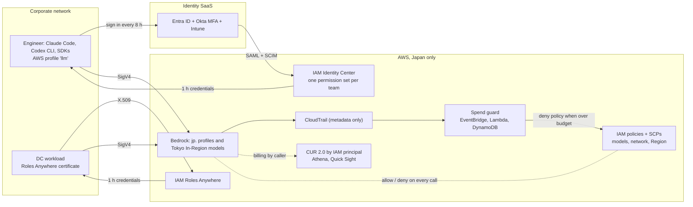

# IAM-native LLM gateway on AWS: system documentation

Documentation for an internal LLM gateway that has **no gateway server**. Engineers and workloads call Amazon Bedrock directly in Tokyo (`ap-northeast-1`), with Osaka (`ap-northeast-3`) for DR. AWS itself does the gateway's work:

- **IAM Identity Center** (federated from Entra ID, Okta Verify MFA, Intune-compliant device) gives people short-lived credentials.
- **IAM policies and SCPs** decide who may call which model, from which network, in which Region.
- **CUR 2.0 cost allocation by IAM principal** charges every call to a person and a team.
- **AWS Budgets** and a small serverless **spend guard** stop spending at the budget.
- **The AWS console**, CloudWatch dashboards, and Amazon Quick Sight dashboards show the access lifecycle, and spend.

It is an alternative to the LiteLLM-based design in [`../ai-gateway-on-aws`](../ai-gateway-on-aws/README.md), cited as `[LGW …]`, and keeps as many of its requirements as AWS can meet without a proxy. [`docs/en/adr/D-1-no-gateway-in-the-request-path.md`](docs/en/adr/D-1-no-gateway-in-the-request-path.md) has the requirement-by-requirement comparison: what is kept, what changes, and what is lost.

The design analysis behind both designs is in [`../llm-gateway-comparison`](../llm-gateway-comparison/README.md) (English is authoritative), cited as `[CMP §n.n]`, `[CMP A-n]` (assumption) and `[CMP V-n]` (launch gate). The set follows the template in [`../llm-gateway-docs-template`](../llm-gateway-docs-template/README.md).

**Status: design phase.** Nothing is built yet, and this repository holds no code or IaC. 00, 01, 02, 11 and the decision records are written as Drafts for review. 03–10 are stubs: they follow the template's structure, already describe this design rather than LiteLLM, and keep `[fill]` markers for what is decided during the build.

| # | Document | Answers | Owner |
|---|---|---|---|
| 00 | [Overview](docs/en/00-overview.md) | What it is, scope, owners, service levels | Product owner |
| 01 | [Requirements](docs/en/01-requirements.md) | What it must do and how well; assumptions; model catalog | Product owner, with security, legal, FinOps |
| 02 | [Architecture and design](docs/en/02-architecture-and-design.md) | How it is built; IAM model; security design; DR; verification and traceability | Platform engineering |
| 03 | [Installation and setup](docs/en/03-installation.md) | Bootstrapping a new AWS environment; teardown | Platform engineering |
| 04 | [Configuration reference](docs/en/04-configuration.md) | Every policy, setting and switch, and which are security-critical | Platform engineering |
| 05 | [User guide](docs/en/05-user-guide.md) | Getting access, tool setup, tasks for users and team leads | Product owner |
| 06 | [API reference](docs/en/06-api-reference.md) | Endpoints, auth, errors, limits, versioning | Platform engineering |
| 07 | [Operations runbook](docs/en/07-operations-runbook.md) | Deploy, rollback, alerts, incidents, DR, maintenance | On-call / SRE |
| 08 | [Troubleshooting and FAQ](docs/en/08-troubleshooting-faq.md) | Symptoms, causes, fixes; common questions | Support + platform |
| 09 | [Development guide](docs/en/09-development-guide.md) | Repo layout, workflow, policy changes, tests | Platform engineering |
| 10 | [Release notes](docs/en/10-release-notes.md) | What changed and what callers must do | Platform engineering |
| 11 | [Appendices](docs/en/11-appendices.md) | Glossary, links, contacts, approval checklist | Documentation owner |
| ADR | [Decision records](docs/en/adr/) | Why one significant design choice was made; one file per decision, copied from [`TEMPLATE.md`](docs/en/adr/TEMPLATE.md) | Decision owner |

## The design in one picture



## Cost estimate

Not made yet. The infrastructure is a handful of serverless components (02 §12), so model usage dominates even more than in the LiteLLM design. When an estimate is needed, make it from [`../cost-estimate-template`](../cost-estimate-template/README.md), as `[LGW]` did in its `cost/` folder.

## Who reads what

| Reader | Start with | Then |
|---|---|---|
| New team member | 00, 02 | 03, 09 |
| Engineer using the gateway | 05 | 08 |
| Integrator / workload owner | 06 | 05 §4, 04 |
| On-call | 07 | 08, 04 |
| Security / privacy reviewer | 02 §4, §7, §8 | 01 §7, 04 §4.2 |
| FinOps | 01 §6.4 | 02 §5, 07 §5 |
| Manager / stakeholder | 00, ADR D-1 | 10 |

## Where each fact lives

Each fact has one home. Other documents refer to it (for example "see 04 §4.3") instead of repeating it. The set then cannot contradict itself, and each fact is written once, to one level of detail.

| Fact | Home | Referred to from |
|---|---|---|
| System name, model endpoints, document owners, review cadence | 00 Document control | Used as they are everywhere |
| Who is responsible for what | 00 §1.3 | 11 §C |
| Scope and non-goals, with reasons | 01 §1.3 | 00 §1.1 names them only |
| What is kept, changed and lost compared with the LiteLLM design | ADR D-1 §5 | 00 §1.6, 01 §1.5 |
| Assumptions and constraints | 01 §3–4 | 00 §1.5 summarises the main ones |
| Targets (SLO, RTO/RPO, latency) and requirement text | 01 | 00 §1.4 quotes the IDs only |
| Model catalog: what is needed | 01 §6.5 | 02 §5.1, 04 §4.1 |
| Data classification and retention periods | 01 §8 | 02 §7.1 (how retention is enforced) |
| Design decisions, components, data stores, threat model | 02 (decisions: a summary row in §13; full reasoning in `adr/D-<n>-*.md` when needed) | 03, 07 |
| Requirement ↔ design ↔ test links | 02 §11.3 | 01 §10 |
| Launch gate results | 02 §11.2 | 07, 09, 10 |
| Environments: accounts, regions | 03 §2 | 02 §10, 04 §2.1, 07 |
| Policy and setting names and values, including session lengths, budgets, thresholds and model configuration | 04 | 02 names the settings it depends on; 05, 06, 07 and 08 refer to them |
| Status codes and what callers do about them | 06 §4 | 02 §3.2 (metering and logging only), 08 |
| Step-by-step procedures | 03 (one-time), 07 (operational), 09 (change) | 02 |
| Notice periods for breaking changes and model retirements | 10 §1 | 05 §6, 06 §5 |
| Terms | 11 §A | 01 §12 and every other document |
| Contact details | 11 §C | 00 §1.3, 07 §7, 08 §4 |

## Workflow

1. Approve 00 and 01 first. Start with use cases, constraints, assumptions and the model catalog.
2. Write 02 against a named requirements version.
3. Write 03–09 as the system is built. The pilot fills 08.
4. Before launch, run the launch gates (02 §11.2) and tick the checklist in 11 §D.
5. After launch, update 10 with every release. Run the gates again after every change to a security-critical policy (04 §4.2), and when AWS announces a change to a Bedrock, IAM or CloudTrail behaviour that a gate depends on (OPS-001).

## Writing conventions

These rules keep the level of detail the same across the set, whoever writes each part. The comment at the top of each template file adds what is specific to that document.

### Markers in the template

| Marker | Means | What to do |
|---|---|---|
| `[fill]`, `[fill: hint]` | No value yet. The hint says what is wanted. | Replace the whole marker with the value. |
| `[default: value]` | A proposed value, usually from the comparison or `[LGW]`. | Keep the value and remove the marker, or replace it. |
| `EXAMPLE:` at the start of a row, block or diagram (after the ID, in a row that has one) | An illustration of the expected detail. | Replace it with real content, or delete it. |
| `<…>` inside a code span or code block | The part that changes each time the line or block is used. | Leave the template as it is; replace the `<…>` parts in your copy. |
| Text with no marker | Already decided for this gateway. | Check that it is still true. Change it only through review. |

A citation keeps its own brackets inside a marker: `[default: remote and home access [CMP A-13]]`.

### Finished cells and fields

Every table cell and every field in a block ends in one of these states:

- a value;
- `—`, where "none" is a correct answer (for example, a setting with no default);
- `n/a: <reason>`, where the item does not apply to this system;
- `TBD (<owner>, <YYYY-MM-DD>)`, for a known gap. It is allowed while a document is Draft or In review. An approved document keeps a TBD only if the gap is also tracked in 01 §9 or 02 §14.

Never leave a cell blank, and never delete a field from a block or a pre-filled row from a table: write `n/a: <reason>` instead. A blank cell cannot be told apart from a forgotten one.

### Detail standard

- **Specific to this system.** Name the real thing: the policy, permission set, setting key, dashboard link, group or team. "The dashboard" or "configure appropriately" is not enough.
- **Numbers carry units and scope.** A target also states its window and where it is measured.
- **Procedures are runnable.** Each step is one action, then a `Run:` line with the exact command or console path, then an `Expect:` line with what the reader sees when it worked. A new team member can follow it without asking anyone.
- **Tables are complete.** One row per item, every column filled. A table that the template leaves empty has one `EXAMPLE` row to copy the detail from.
- **Owners are teams or roles.** People are named only in document control and status lines, approvals, change logs and 11 §C.
- **Prose stays short.** A summary or problem statement is two to five sentences. Anything longer becomes a table or a list.
- **One fact, one home.** Where another document owns a fact, write the reference, not the value (see [Where each fact lives](#where-each-fact-lives)).

### Repeated blocks

Some sections are a list of entries with the same fields: user tasks (05 §5), endpoint details (06 §3.4), incident procedures (07 §6) and releases (10 §3). Each of these sections starts with a block template in a code block. Copy it for each entry, and keep every field, in the same order.

Decision records work the same way at file level: copy [`docs/en/adr/TEMPLATE.md`](docs/en/adr/TEMPLATE.md) to `docs/en/adr/D-<n>-<short-title>.md`, with the same `D-n` as its row in 02 §13, and keep every section.

### References

| Reference to | Write it as | Example |
|---|---|---|
| A section in another document of the set | File number and section | `04 §4.2` |
| A section in the same document | Section only | `§4.2` |
| A whole document of the set | File number and title | `04 Configuration reference` |
| A requirement, test, gate, decision or risk | Its ID | `RES-001`, `T-001`, `V-1`, `D-1`, `R-1` |
| The comparison analysis | `CMP` and the section, assumption or gate, in square brackets | `[CMP §2.7]`, `[CMP A-13, A-14]`, `[CMP V-7]` |
| The LiteLLM design (`../ai-gateway-on-aws`, commit `87ba355`) | `LGW`, the document number, and the section or ID, in square brackets | `[LGW 02 D-27]`, `[LGW 01 TEN-001]` |
| Anything outside the set | A Markdown link | `[Bedrock API keys](https://docs.aws.amazon.com/bedrock/latest/userguide/api-keys.html)` |

The launch gates in 02 §11.2 keep the comparison's IDs: `V-1` names our gate and its results, and `[CMP V-1]` names its definition in the comparison. Gates that only apply to LiteLLM keep their row as `n/a`.

Requirement IDs are taken over from `[LGW 01]` where the requirement means the same thing, so the two designs can be compared row by row. A requirement that does not apply without a proxy keeps its row with status `Withdrawn`. New requirements get new numbers.

### Document status and IDs

- 01 and 02 are approved baselines, so each carries its own version, approvers and change log. The other documents are living documents: they follow the release in 10, carry an owner and a last-reviewed date in the status line at the top, and are reviewed on the cadence set in 00.
- Requirement IDs (`RES-001`, `AVL-M01`, …) are never reused or renumbered.
- English is authoritative. To keep a Japanese set, follow the comparison repo: same filenames under `docs/jp/`, updated in the same PR.

### Checking a document

Before a document goes to review, this prints nothing (replace `NN` with the file number):

```sh
grep -nE '\[(fill|default)[]:]|EXAMPLE|<!--|\|[[:space:]]*\|' docs/en/NN-*.md
```

It finds markers that were not replaced, examples, instruction comments and blank table cells. For a decision record, use `docs/en/adr/D-<n>-*.md` as the path. `grep -n 'TBD (' docs/en/NN-*.md` lists the gaps that are still open. Before the set is approved, run both over `docs/` with `grep -rn --exclude=TEMPLATE.md`, since the ADR template keeps its markers, and tick the checklist in 11 §D.
