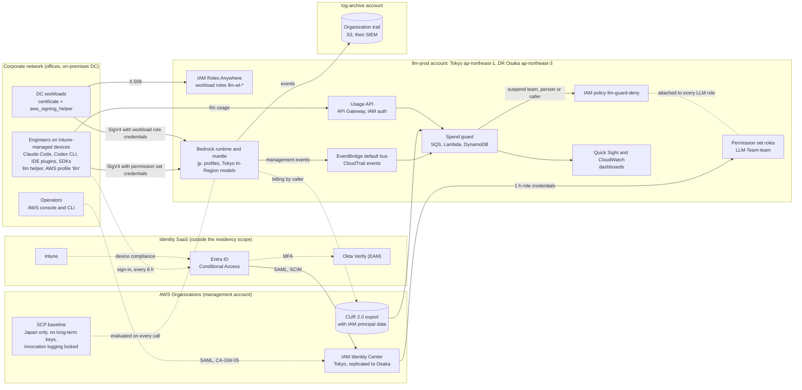
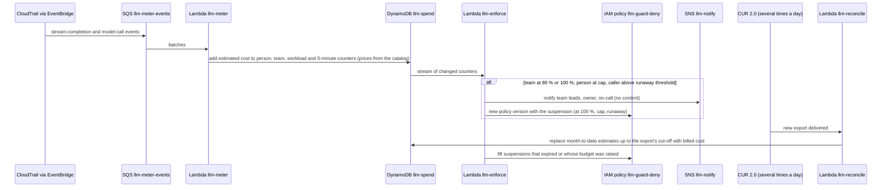

# IAM-native LLM gateway: Architecture and design specification

| Field | Value |
|---|---|
| Document ID | SPEC-IGW |
| Version | 0.1 |
| Status | Draft |
| Owner | TBD (Platform engineering, 2026-12-18): named in 01 Q-1 |
| Approvers | Security, network, platform lead, FinOps, SRE |
| Requirements baseline | REQ-IGW 0.1 |
| Source analysis | llm-gateway-comparison commit `46699eb` (2026-11-17); the LiteLLM design, ai-gateway-on-aws commit `87ba355` (2026-11-20) |
| Last updated | 2026-11-20 |

## 1. Overview

### 1.1 Summary

There is no gateway server. Engineers' tools and DC workloads call Amazon Bedrock directly at its regional endpoints in Tokyo, signed with AWS credentials that last one hour (D-1). People get those credentials from IAM Identity Center, federated from Entra ID with Okta Verify MFA and an Intune-compliant device, through one permission set per team (D-2); DC workloads get them from IAM Roles Anywhere with a certificate (D-4). On every call, IAM evaluates three layers: an SCP that allows only `jp.` profiles and Tokyo In-Region models in Japanese Regions, the team's permission policy with its model list and the office network condition, and the spend guard's deny policy (§4.7). AWS bills every call to the IAM principal that made it, so CUR 2.0 gives cost per person, team and workload directly (D-9); a serverless spend guard reads CloudTrail through EventBridge and denies a team, a person or a runaway caller within minutes of crossing a limit (D-8). No prompt content is stored, and every store, log and export is in Tokyo or Osaka.

### 1.2 Requirements baseline

This design implements REQ-IGW version 0.1. Requirements it does not cover yet:

| Requirement | Reason not covered | Planned in |
|---|---|---|
| SEC-008, SEC-009 | Deferred: no guardrail can screen Japanese text in Japan without a proxy (D-10, R-5) | TBD (Security / SOC, 2026-12-18): after 01 Q-13 |
| PRV-002 | The mechanism is designed (D-11), but whether any team needs it is open | TBD (Legal / privacy, 2026-12-18): after 01 Q-10 |
| FUN-002 | Which Japan-processed models Codex CLI can use through Bedrock's Responses API is not known yet (R-4) | TBD (Platform engineering, 2027-01-29): after T-002 |
| MDL-011 | Whether Bedrock offers an OpenAI GPT model processed only in Japan is not checked | TBD (Product owner, 2026-12-18): after 01 Q-4 |
| SEC-014 | The private path is proposed for general availability only (D-6) | TBD (Network, 2027-01-29): after 01 Q-24 |

### 1.3 Pinned versions

There is no server software of ours in the request path, so the versions that matter are the clients' and the spend guard's.

| Component | Version / image digest | Notes |
|---|---|---|
| Claude Code | TBD (Platform engineering, 2027-01-29) | Bedrock mode with `awsAuthRefresh`; the minimum version is set after T-001 and pushed by Intune |
| Codex CLI | TBD (Platform engineering, 2027-01-29) | The `amazon-bedrock` provider; OpenAI's help article gives 0.128.0 as the minimum ([Codex with Bedrock](https://help.openai.com/en/articles/20001253-configure-codex-with-amazon-bedrock)), not checked by us (R-4) |
| AWS CLI v2 | TBD (Platform engineering, 2027-01-29) | A version whose `aws sso login` uses the authorization code flow with PKCE by default (R-7) |
| `llm` helper (client package) | TBD (Endpoint / Intune, 2027-01-29) | Ours; built in `clients/` (09 §1) |
| Roles Anywhere credential helper (`aws_signing_helper`) | TBD (Platform engineering, 2027-01-29) | On DC workload hosts |
| Spend guard and usage API | Lambda runtime TBD (Platform engineering, 2027-01-29); code version is the release unit (§10) | Ours; signed with AWS Signer (SEC-016) |
| IaC tool | TBD (Platform engineering, 2027-01-29) | CDK or Terraform (R-24) |

## 2. Architecture

**Satisfies:** RES-001, RES-003, SEC-004, AVL-001, OPS-002, FUN-001, FUN-002, FUN-003, FUN-008, FUN-009, IAM-001, IAM-002, CST-001, RES-004, RES-005, OBS-002, OBS-003

### 2.1 Context diagram



### 2.2 Component table

| Component | AWS service / resource | Region(s) | Purpose | Satisfies | Owner |
|---|---|---|---|---|---|
| Model service | Bedrock `bedrock-runtime` (InvokeModel, Converse, Messages, Chat Completions, Responses) and `bedrock-mantle` (OpenAI-compatible APIs) in `llm-prod`; `jp.` system inference profiles and Tokyo In-Region models (D-5) | ap-northeast-1; ap-northeast-3 for DR; `bedrock-mantle` only in ap-northeast-1 | The only model service; processes in Japan only | FUN-001 to FUN-004, RES-002, MDL-101 | Platform engineering |
| Sign-in for people | IAM Identity Center organization instance, Entra as external IdP (SAML 2.0, SCIM), access portal session 8 h (D-2) | Home ap-northeast-1, replicated to ap-northeast-3 (D-13) | Turns an Entra sign-in into 1-hour role credentials | IAM-001, IAM-004, IAM-011, IAM-016 | Identity, with Cloud platform |
| Team permission sets | One permission set `LLM-Team-<team>` per team, assigned to the Entra group `llm-team-<team>` on `llm-prod` (§4.2) | IAM is global; roles exist in `llm-prod` | The team's model tier, network condition and attribution | TEN-001, TEN-004, TEN-009, MDL-103, CST-001 | Platform engineering |
| Workload credentials (DC) | IAM Roles Anywhere trust anchor on AWS Private CA; one role `llm-wl-<team>-<workload>` per workload, bound to its egress IPs (D-4) | ap-northeast-1; trust anchor and profile also in ap-northeast-3 | 1-hour credentials from a certificate, no secret key to store | TEN-002, TEN-006, OBS-008, IAM-016 | Platform engineering |
| Workload accounts (AWS) | Enrolled AWS accounts call Bedrock with their own IAM roles, under the SCP baseline, with their own AWS Budget (D-4, D-18) | ap-northeast-1, ap-northeast-3 | Native per-account cost, quotas and budgets | CST-007, CST-014, RES-002 | Account owners, with Cloud platform |
| Residency and key guardrails | SCP `scp-llm-baseline` (§4.7, 04 §4.2); AWS Config rules for drift | All accounts; denies Regions outside Tokyo and Osaka | Japan-only models, no IAM-user model calls, no long-term Bedrock API keys, invocation logging locked, enrolment list | RES-002, RES-003, RES-008, IAM-015, MDL-101 | Cloud platform, with Security / SOC |
| Spend guard | EventBridge rules, SQS queue `llm-meter-events`, Lambda functions `llm-meter`, `llm-reconcile`, `llm-enforce`, `llm-lifecycle`, `llm-admin`, DynamoDB global table `llm-spend`, IAM policy `llm-guard-deny`, SNS topic `llm-notify` (§5.2, D-8) | ap-northeast-1, standby in ap-northeast-3 | Near-real-time spend per person, team and workload; budget, cap and runaway denials; leaver denials | CST-002, CST-004, CST-010, CST-012, CST-013, IAM-006, AVL-007 | Platform engineering |
| Usage API | API Gateway regional REST API with IAM authorization; Lambda `llm-usage` (D-14) | ap-northeast-1 | `llm usage`: the caller's own usage and their team's, as PRV-003 allows | FUN-008, IAM-010 | Platform engineering |
| Client package | `llm` helper (sign-in, team choice, Region, usage, short-term keys); Claude Code managed settings; Codex CLI `config.toml`; pushed by Intune (D-12) | Corporate devices | Tools reach Bedrock with no user configuration | FUN-005, FUN-008, FUN-009 | Endpoint / Intune, with Platform engineering |
| Billing and chargeback | CUR 2.0 data export with IAM principal data, cost allocation tags, AWS Budgets with actions, Athena (D-9) | ap-northeast-1 (export bucket and Athena) | Cost truth, chargeback, workload budgets | CST-007, CST-011, CST-014, RES-004 | FinOps |
| Dashboards | CloudWatch dashboards (operations); Amazon Quick Sight with IAM Identity Center sign-in and row-level security (spend, access inventory) (D-14) | ap-northeast-1 | Operations, chargeback, access lifecycle views | OBS-003, OBS-010, IAM-014 | Platform engineering, with FinOps |
| Audit and logging | Organization CloudTrail trail to the log-archive account, then the SIEM; CloudTrail data events for `bedrock-mantle`; Config; GuardDuty; Security Hub; IAM Access Analyzer | Trail home ap-northeast-1 | Audit of every call and every access change, with no content | OBS-001, OBS-002, OBS-004, OBS-007, SEC-019 | Security / SOC, with Platform engineering |
| Private path (general availability, if adopted) | Interface VPC endpoints for `bedrock-runtime`, `bedrock-mantle`, `bedrock`, `sts`, `rolesanywhere` in an endpoint VPC in `network-prod`, reached over Direct Connect and Transit Gateway; Route 53 Resolver inbound endpoints; org-only endpoint policies (D-6) | ap-northeast-1; ap-northeast-3 for DR | Keeps calls off the internet and other AWS accounts off our network path to Bedrock | SEC-014, RES-007 | Network |
| Operator access | IAM Identity Center permission sets `LLM-ReadOnly`, `LLM-Operator`, `LLM-FinOps` (production) and `LLM-Admin` (dev and staging), behind CA-GW-05 (D-16) | Global (IAM) | Console and CLI access with 1 h sessions | IAM-003, IAM-007, IAM-008, IAM-013 | Identity, with Platform engineering |
| CI pipeline | CI system TBD (R-24), federated to IAM role `llm-platform-deploy` by OIDC, protected branches only (D-15) | — | The only writer of policies, permission sets, roles, budgets and configuration | OPS-002, OPS-003, SEC-012, SEC-021 | Platform engineering |
| Threat detection | GuardDuty, Security Hub, Config rules, IAM Access Analyzer (unused access) | ap-northeast-1, ap-northeast-3 | Detection and configuration compliance | SEC-019 | Security / SOC |

### 2.3 Request flows

#### 2.3.1 Sign-in and team choice (once a day)

The device and MFA are checked here, at least every 8 hours (IAM-011) [CMP §2.2, §2.3.1].

```mermaid
sequenceDiagram
  actor U as Employee (Intune-managed device)
  participant H as llm helper
  participant P as IAM Identity Center (Tokyo)
  participant E as Entra ID (Conditional Access)
  participant I as Intune
  participant O as Okta Verify (EAM)
  U->>H: llm login (or Claude Code runs it through awsAuthRefresh)
  H->>P: aws sso login: authorization code flow with PKCE, browser on the same device
  P-->>U: redirect to Entra (SAML)
  U->>E: primary sign-in
  E->>I: device compliant? (CA-GW-01)
  I-->>E: compliant
  E-->>U: MFA through Okta
  U->>O: Okta Verify challenge
  O-->>E: MFA satisfied
  E-->>P: SAML assertion
  P-->>H: access-portal token, valid for the portal session (8 h)
  H->>P: list my accounts and roles
  P-->>H: LLM-Team-payments, LLM-Team-search (one per team group)
  Note over H: one team: chosen automatically; several: ask once, remember (TEN-009)
  H->>H: write AWS profile "llm" for the chosen permission set and Region
```

#### 2.3.2 Interactive call

```mermaid
sequenceDiagram
  participant C as Claude Code (or Codex CLI, SDK)
  participant S as AWS SDK credential chain (profile llm)
  participant P as IAM Identity Center
  participant B as Bedrock runtime (Tokyo)
  participant IAM as IAM evaluation
  participant T as CloudTrail and EventBridge
  C->>S: credentials for profile llm
  alt cached role credentials expired (every hour)
    S->>P: GetRoleCredentials with the access-portal token
    P-->>S: 1 h credentials for AWSReservedSSO_LLM-Team-payments, session name = user name
  end
  S-->>C: credentials
  C->>B: InvokeModelWithResponseStream, model jp.anthropic.claude-opus-5-5 (SigV4)
  B->>IAM: authorize
  Note over IAM: SCP: Japan Region, jp. profile or Tokyo In-Region model<br/>permission set: model in the team's tier, office IP or our endpoint<br/>llm-guard-deny: team, person or caller not suspended
  IAM-->>B: allow
  Note over B: jp. profile routes to Tokyo or Osaka only
  B-->>C: stream
  B->>T: AwsApiCall event, then stream-completion event with input and output tokens
  Note over T: principal, source IP, user agent, model; no content
```

#### 2.3.3 DC workload call

```mermaid
sequenceDiagram
  participant W as Workload (on-prem DC)
  participant A as aws_signing_helper (credential_process)
  participant R as IAM Roles Anywhere (Tokyo)
  participant B as Bedrock runtime (Tokyo)
  W->>A: credentials for the workload profile
  A->>R: CreateSession, signed with the workload's private key and certificate
  Note over R: certificate chains to the trust anchor (AWS Private CA), not revoked (CRL), subject matches the role's trust policy
  R-->>A: 1 h credentials for llm-wl-payments-invoicing
  A-->>W: credentials
  W->>B: Converse, from the workload's registered egress IP
  Note over B: the role allows only its model list and only from its egress CIDRs (OBS-008); its tags Team, CostCenter, Workload appear in CUR
  B-->>W: response
```

#### 2.3.4 Refused call

```mermaid
sequenceDiagram
  participant C as Client
  participant B as Bedrock
  participant IAM as IAM evaluation
  C->>B: call with missing, wrong or expired credentials
  B-->>C: 403 (UnrecognizedClientException, ExpiredTokenException), no model call, no charge
  C->>B: call from a home IP with valid credentials
  B->>IAM: authorize
  IAM-->>B: explicit deny: network condition in the permission policy
  B-->>C: 403 AccessDeniedException, no model call, no charge
  C->>B: call to global.* profile, a model outside the tier, or a non-Japan Region
  IAM-->>B: explicit deny (SCP) or no allow (permission policy)
  B-->>C: 403 AccessDeniedException
  C->>B: call while the team, the person or the caller is suspended
  IAM-->>B: explicit deny: llm-guard-deny
  B-->>C: 403 AccessDeniedException
  C->>B: call above the account quota for the model
  B-->>C: 429 ThrottlingException
  Note over C,B: every refusal is a CloudTrail event with an errorCode; no model is called
```

#### 2.3.5 Budget enforcement



## 3. Interfaces

**Satisfies:** FUN-001, FUN-002, FUN-003, FUN-004, FUN-005, FUN-006, FUN-007, MDL-102, IAM-002, CST-002, CST-005, CST-006, AVL-003, SEC-020, OBS-006

### 3.1 Client-facing API

Clients use Bedrock's own APIs; the gateway adds nothing to them. What it controls is which IAM actions, models and Regions each principal may use (§4.7).

| API style | Auth modes | Clients | Why exposed | Satisfies |
|---|---|---|---|---|
| Bedrock InvokeModel and InvokeModelWithResponseStream, with the Anthropic Messages body for Claude (`bedrock-runtime`) | SigV4 (permission set or workload role); short-term Bedrock API key | Claude Code in Bedrock mode; Anthropic SDK's Bedrock client; workloads | Claude Code calls these natively [CMP §2.3.4] | FUN-001 |
| Anthropic Messages API (`/anthropic/v1/messages` on `bedrock-runtime`) | SigV4; short-term API key | Tools that use the Anthropic Messages format with a base URL | Bedrock serves it for Claude models ([Bedrock endpoints](https://docs.aws.amazon.com/bedrock/latest/userguide/endpoints.html)) | FUN-001 |
| Bedrock Converse and ConverseStream (`bedrock-runtime`) | SigV4; short-term API key | AWS SDKs, IDE plugins with Bedrock support, workloads | One request format for every chat model | FUN-003 |
| OpenAI Chat Completions (`/openai/v1/chat/completions` on `bedrock-runtime`) | SigV4; short-term API key | OpenAI SDK, IDE plugins | Only for models Bedrock offers on it, for example gpt-oss-120b | FUN-003 |
| OpenAI Responses (`bedrock-runtime` `/openai/v1/responses`, or `bedrock-mantle` `/v1/responses`) | SigV4; short-term API key | Codex CLI (`amazon-bedrock` provider) | Codex CLI uses it; which models qualify is R-4; storage must be off (PRV-005, R-3) | FUN-002 |
| InvokeModel for embeddings (`bedrock-runtime`) | SigV4; short-term API key | Workloads | Only if an embedding model is in the catalog (01 Q-5) | FUN-004 |
| `bedrock:ListInferenceProfiles`, `bedrock:GetInferenceProfile` (`bedrock`) | SigV4 | Claude Code; `llm models` | Claude Code checks profiles; the list is not filtered by IAM, so `llm models` shows the team's tier from the catalog (FUN-005) | FUN-005 |
| Usage API `GET /usage/me`, `GET /usage/team/{team}` (API Gateway) | SigV4 (`execute-api:Invoke`) | `llm usage` | A person's own usage and their teams' (IAM-010) | FUN-008, IAM-010 |
| Every other Bedrock operation: batch and asynchronous invoke, agents, knowledge bases, flows, prompt management, custom models, provisioned throughput, guardrail administration, image and video models, model invocation logging | — | — | Not allowed: no permission policy allows them, and the SCP denies the high-risk ones (§4.7) [CMP §10.8.7] | FUN-006, SEC-020 |

### 3.2 Error behaviour

| Condition | Metered (charged to the team)? | Logged where | Satisfies |
|---|---|---|---|
| Missing, wrong or expired signature or key | No: refused before the model call | CloudTrail event with `errorCode` | IAM-002 |
| Network condition fails (not an office or DC IP, not our endpoint) | No: refused by IAM | CloudTrail `AccessDenied` event with the source IP | SEC-001 |
| Model outside the team's tier, not in the catalog, or outside Japan | No: refused by IAM or SCP | CloudTrail `AccessDenied` event | MDL-101, MDL-102, MDL-103 |
| Team, person or caller suspended by the spend guard | No: refused by IAM | CloudTrail `AccessDenied` event; the suspension and its reason in `llm-spend` and the SIEM | CST-002, CST-012, CST-013 |
| Account quota for the model reached | No: Bedrock throttles before processing | CloudTrail `ThrottlingException`; Bedrock CloudWatch metrics | PRF-M02 |
| Model error after processing started | As Bedrock bills it; CUR is the truth | CloudTrail; CUR | CST-007 |
| Client cancels a stream or times out | As Bedrock bills it; the spend guard's estimate for it is measured by V-5 | CloudTrail; CUR | CST-006 |
| A client asks for no logging | n/a: there is no such option; billing and CloudTrail do not depend on the client | CloudTrail; CUR | CST-005 |

### 3.3 External dependencies

| Dependency | Direction | Protocol / endpoint | Failure behaviour | Monitored by |
|---|---|---|---|---|
| Entra ID (SAML IdP, SCIM client) | Inbound to IAM Identity Center | SAML from the user's browser; SCIM from Entra's provisioning service to Identity Center's SCIM endpoint | New sign-ins fail; people already signed in keep working until their portal session ends; provisioning changes wait (V-10, R-10) | Entra provisioning logs; an alarm on failed SCIM cycles and on a drop in Identity Center sign-ins (OBS-006) |
| IAM Identity Center | Outbound from clients | Access portal and OIDC endpoints in ap-northeast-1 (ap-northeast-3 after failover) | New role credentials cannot be issued; existing ones work for up to 1 hour | Identity Center sign-in and `GetRoleCredentials` errors in CloudTrail |
| Bedrock | Outbound from clients | Regional endpoints (§6) | Throttling or errors are returned to the client; `jp.` profiles route between Tokyo and Osaka on their own | Bedrock CloudWatch metrics per model, including quota consumption and time to first token |
| IAM Roles Anywhere and AWS Private CA | Outbound from DC workloads | `rolesanywhere` regional endpoint | Workloads cannot refresh credentials; existing ones work for up to 1 hour | CloudTrail `CreateSession` errors; certificate expiry alarms |
| CloudTrail to EventBridge | Internal | Default event bus, rule state `ENABLED_WITH_ALL_CLOUDTRAIL_MANAGEMENT_EVENTS` ([EventBridge](https://docs.aws.amazon.com/eventbridge/latest/userguide/eb-service-event-cloudtrail-management.html)) | Metering stops; enforcement stays at its last state; model calls continue (AVL-007) | Alarm when no event arrives for 15 minutes during working hours (OBS-006) |
| CUR 2.0 export | Internal | S3 delivery in the management account's billing bucket | Reconciliation waits; estimates keep running | Alarm when no export arrives for 36 hours (OBS-006) |
| SIEM | Outbound | From the log-archive account's S3 and CloudWatch Logs; the SIEM's ingestion path TBD (Security / SOC, 2027-01-29) (R-34) | Logs queue; nothing in the request path depends on it | Delivery errors |

## 4. Identity and access

**Satisfies:** IAM-001, IAM-002, IAM-003, IAM-004, IAM-005, IAM-006, IAM-007, IAM-008, IAM-009, IAM-010, IAM-011, IAM-013, IAM-014, IAM-015, IAM-016, TEN-001, TEN-002, TEN-003, TEN-004, TEN-005, TEN-006, TEN-007, TEN-008, TEN-009, FUN-008, FUN-009, SEC-012, SEC-020, SEC-021, OBS-005, OBS-007, OBS-008, REG-004, CST-011

### 4.1 Authentication per client type

| Client type | Auth mode | Token / key source | Lifetime / rotation | Device check |
|---|---|---|---|---|
| Claude Code (engineer) | SigV4 with permission set credentials, AWS profile `llm` (D-12) | AWS SDK credential chain; `awsAuthRefresh` runs `llm login` when the portal session has ended | Role credentials 1 h, refreshed silently from the portal token; portal session 8 h (04 §4.4) | CA-GW-01 at every sign-in, so at least every 8 h; the network condition on every call while A-16 holds |
| Codex CLI (engineer) | SigV4 through the `amazon-bedrock` provider with AWS profile `llm` | As Claude Code; set in a user-level `config.toml` pushed by Intune | As Claude Code | As Claude Code |
| SDKs and IDE plugins that support AWS profiles | SigV4, AWS profile `llm` | As Claude Code | As Claude Code | As Claude Code |
| Tools that accept only a bearer key | Short-term Bedrock API key from `llm token`, made locally from the permission set credentials ([token generator](https://docs.aws.amazon.com/bedrock/latest/userguide/api-keys.html)) | Pasted into the tool, or read from an environment variable the tool's launcher sets | The rest of the 1 h role session; works only in the Region it was made for (R-20, R-26) | As Claude Code |
| DC workload | SigV4 with workload role credentials from IAM Roles Anywhere (D-4) | `aws_signing_helper` as `credential_process`; certificate and private key on the host, in a TPM or HSM where available | Role credentials 1 h; certificate at most 90 days, renewed by the workload's certificate automation (TEN-006) | None on the host; the role works only from the workload's egress CIDRs (OBS-008) |
| Workload in an enrolled AWS account | SigV4 with the workload's own IAM role in its own account (D-4) | The compute service's role (ECS task role, Lambda execution role, EC2 instance profile) | Temporary credentials issued by AWS | n/a: an AWS role, governed by the account's owner and the SCP baseline |
| CI pipeline | SigV4 with role `llm-platform-deploy`, through the CI system's OIDC provider (D-15) | OIDC token for a protected-branch job | Per job, 1 h at most | Trust policy restricted to the repository and protected branches (SEC-012, SEC-021) |
| Spend guard functions | Lambda execution roles | AWS | Temporary | n/a: an AWS service role |
| Operators | IAM Identity Center permission sets through CA-GW-05 (D-16) | `aws sso login` or the console | 1 h sessions (IAM-008) | CA-GW-05: phishing-resistant MFA, compliant device, office IP |
| Long-term keys of any kind | Not possible: the SCP denies model calls by IAM users and the creation and use of long-term Bedrock API keys (D-3) | — | — | — |

### 4.2 Authorization and role mapping

| Entra group / claim | AWS permission set or role | Permissions | Provisioning (SCIM / JIT) |
|---|---|---|---|
| Security group `llm-team-<team>` | Permission set `LLM-Team-<team>` on `llm-prod` (role `AWSReservedSSO_LLM-Team-<team>_<suffix>`), session 1 h | Invoke the models in the team's tier (`standard` or `premium`, 04 §4.1) through `jp.` profiles and Tokyo In-Region IDs; short-term API keys; list inference profiles; the usage API; nothing else. Network condition and `llm-guard-deny` attached (§4.7) | Group and members provisioned by Entra SCIM; the assignment of the group to the permission set made by CI from the team list in Git (D-15). Group naming: R-9 |
| Groups `llm-team-<team>` for teams approved for Codex CLI (04 §4.1) | The same permission set, with `bedrock-mantle:CreateInference` and the Responses API added | As above, plus the Responses API on the models approved for Codex CLI | As above |
| Group `llm-readonly` | Permission set `LLM-ReadOnly` on `llm-prod`, `llm-staging` and the log-archive account, session 1 h | Read-only: IAM, Identity Center assignments, CloudTrail, `llm-spend`, CloudWatch; no model calls; platform engineers and Security / SOC in production | SCIM; CA-GW-02 |
| Group `llm-ops` | Permission set `LLM-Operator` on `llm-prod`, session 1 h | `LLM-ReadOnly`, plus invoking `llm-admin` to suspend or restore a person, team or caller (UC-12); no other write | SCIM; CA-GW-02 |
| Group `llm-finops` | Permission set `LLM-FinOps` on the billing data account | Athena and Quick Sight authoring on CUR 2.0 and spend exports | SCIM; CA-GW-02 |
| Group `llm-admins` | Permission set `LLM-Admin` on `llm-dev` and `llm-staging` only | Administer the non-production accounts; production changes go through CI (D-15) | SCIM; CA-GW-02 |
| Group `llm-team-leads` (and department contacts) | Quick Sight reader, through IAM Identity Center | Spend dashboards, with row-level security by team or department (D-14) | SCIM |
| Department mapping | Tag `Department` and `CostCenter` on each team's entry in Git; tags `Team`, `CostCenter`, `Workload`, `Owner` on workload roles | Chargeback by department (CST-011) | CI; FinOps confirms (01 Q-12) |

The group names are proposed; Identity confirms them (R-9). Conditional Access targets groups, because it cannot target the holders of a permission set (§4.4).

### 4.3 Operator access (cloud console and break-glass)

| Item | Design |
|---|---|
| Permission sets per environment | `LLM-ReadOnly`, `LLM-Operator` and `LLM-FinOps` in production; `LLM-Admin` only in dev and staging; deploys only through CI (OPS-002, OPS-003, D-15). Exact policies: 04 §4.2 |
| Session length | 1 h for every operator permission set [CMP §4.4] |
| Source-IP conditions | Deny calls whose `aws:SourceIp` is not an office or DC egress IP, with an `aws:ViaAWSService` exception, in each operator permission set [CMP §4.4] |
| Break-glass access | IAM users in the management account and `llm-prod`, credentials in a vault, MFA on the user; who can open the vault TBD (Security / SOC, 2027-01-29) (R-34). The SCP that denies model calls by IAM users does not stop their administrative use |
| Audit of operator and break-glass use | Organization CloudTrail trail, home region Tokyo, delivered to the SIEM; any break-glass sign-in alerts Security; review frequency TBD (Security / SOC, 2026-12-18) (01 Q-8) |
| Interactive access to compute | n/a: there are no hosts or containers of ours |
| CLI sign-in | `aws sso login` with the authorization code flow and PKCE, browser on the same machine; `--use-device-code` is not used (R-7) |
| Data access for people | `llm-spend` is read through IAM by `LLM-ReadOnly`; writes only by the spend guard's roles; DynamoDB data events in CloudTrail for writes by any other principal (OBS-001) |
| Spend guard break-glass | A CI job, or a break-glass IAM user, sets `llm-guard-deny` back to its empty version; every change to the policy alerts Security (OPS-010) |

### 4.4 Conditional Access policies

The policy set is defined in [CMP §2.1]. All of it now targets one Entra enterprise app, the one for IAM Identity Center, because people reach every AWS account, including `llm-prod`, through it. CA-GW-02 and CA-GW-05 require an Entra-native phishing-resistant method, because Okta through External MFA cannot satisfy an authentication strength [LGW 02 D-29].

| Policy | Applies to | Satisfies |
|---|---|---|
| CA-GW-01 | Every user assigned to the IAM Identity Center app: MFA through Okta External MFA, a compliant device, office and DC named locations, a sign-in frequency of 8 h, and acceptance of the Terms of Use, which records the REG-004 acceptance before the first sign-in | IAM-001, IAM-011, REG-004 |
| CA-GW-02 | Groups `llm-readonly`, `llm-ops`, `llm-finops`, `llm-admins`: a compliant device, the built-in Phishing-resistant MFA authentication strength, and a sign-in frequency of 4–8 h (01 Q-15) | IAM-003 |
| CA-GW-03 | Workload identities | n/a: workloads use IAM roles, not Entra identities [CMP §2.1] |
| CA-GW-04 | IAM Identity Center app: block legacy authentication and device-code flow | IAM-005 |
| CA-GW-05 | Every operator group, for the IAM Identity Center app: the Phishing-resistant MFA authentication strength, compliant device, office/DC named locations, 4–8 h sign-in frequency | IAM-007 |
| CA-GW-06 | Quick Sight: covered by CA-GW-01 or CA-GW-02, because Quick Sight signs in through IAM Identity Center | IAM-014 |

### 4.5 Credential issuance and lifecycle

| Item | Design |
|---|---|
| Credentials people use | Role credentials from their team's permission set, 1 h, refreshed silently from the access-portal token, which lasts the portal session (8 h). No key is ever created for a person (D-2, D-3) |
| Short-term Bedrock API keys | Made by `llm token` from the current role credentials; a pre-signed URL that inherits the session's permissions and expiry, usable only in its Region ([Bedrock API keys](https://docs.aws.amazon.com/bedrock/latest/userguide/api-keys.html)). Allowed by `bedrock:CallWithBearerToken` with `bedrock:bearerTokenType` = `SHORT_TERM` |
| Long-term Bedrock API keys and IAM users | Denied by the SCP everywhere: creating a Bedrock service-specific credential, calling with a `LONG_TERM` token, and any model call by an IAM user (D-3, IAM-015) |
| Who can get which credential | People: only the permission sets of their own team groups (TEN-001, TEN-009). Workload roles, trust anchors, profiles and certificates: only CI, after a pull request from the team lead (TEN-002, D-15) |
| One person, several teams | One permission set per team; `llm team <name>` switches the profile; each session is charged to the team whose permission set it uses (TEN-009, 01 Q-12) |
| Joiners | Added to an `llm-team-*` group in Entra; SCIM provisions the user and the membership; the next `llm login` shows the team (TEN-004) |
| Leavers | Entra disables the account: no new sign-in. SCIM deletes or disables the Identity Center user. `llm-lifecycle` then puts the user name in `llm-guard-deny` for 9 h (portal session plus role session), which ends existing credentials at once; trigger and fallback polling: R-33. Target: 01 Q-8 (IAM-006) |
| Movers | Removed from a team group: SCIM removes the membership, so the old team's permission set can no longer be used; credentials already issued for it end within 1 h. Target: 01 Q-8 (TEN-007) |
| Device falls out of compliance or is lost | The next sign-in is refused (CA-GW-01), at most 8 h later. For a lost device, on-call suspends the person through `llm-admin` until the next sign-in from a new device (07 §6) |
| Credential sharing | Forbidden by the acceptable-use policy; alert when one session's credentials are used from several IPs or user agents (OBS-005) [CMP §2.3.3] |
| Workload certificates | Issued by AWS Private CA from a template with at most 90 days' validity; the subject names the workload; revoked by CI and published as a CRL that Roles Anywhere imports (TEN-006) |
| Workload roles | `llm-wl-<team>-<workload>`: trust policy limited to the trust anchor and the certificate subject; permission policy limited to the workload's model list and egress CIDRs (OBS-008); tags `Team`, `CostCenter`, `Workload`, `Owner`, activated as cost allocation tags (D-9) |
| Acceptable-use policy | Entra Terms of Use, a grant control in CA-GW-01, records acceptance before the first sign-in (REG-004) |
| Contractors and guests | Open (01 Q-21) |

### 4.6 Access by scenario and role

Every way a person or a machine reaches the gateway, what it signs in with, what credential it holds afterwards, and what limits that credential. It extends the scenarios in [CMP §2.9] and [LGW 02 §4.6]. V-12 tests every row that IAM enforces.

| # | Scenario | Who | Sign-in | Credential afterwards | What limits it | Verified by |
|---|---|---|---|---|---|---|
| S1 | Call a model from Claude Code, Codex CLI, an IDE plugin or an SDK | Engineer | None on the call; the session from S2 | Role credentials, 1 h | Network condition; team tier; SCP; `llm-guard-deny` | T-001 to T-005, V-12 |
| S2 | Sign in and choose a team | Engineer | Entra through CA-GW-01: Okta MFA, compliant device, office location, Terms of Use | Access-portal token, 8 h | Only the user's own team permission sets | T-010, T-077, T-085 |
| S3 | See the team's spend and get budget alerts | Team lead | As S2, for `llm usage`; IAM Identity Center for Quick Sight | As S2 | Usage API and Quick Sight row-level security (IAM-010, PRV-003) | T-026, T-059, T-076 |
| S4 | Get a workload role; change a budget, members' tier or models | Team lead | None: a pull request to the configuration repository | None | CI applies reviewed changes (D-15, OPS-003) | T-021, T-067 |
| S5 | Call a model from a DC workload | Workload | Certificate to IAM Roles Anywhere | Workload role credentials, 1 h | Egress CIDRs, model list, budget (CST-014), runaway stop | T-063, T-084, V-12 |
| S6 | Call a model from an AWS workload | Workload in an enrolled account | Its own IAM role | Temporary credentials | SCP baseline; its owner's IAM policies; its AWS Budget (CST-014) | T-086, V-12 |
| S7 | Change policies, permission sets, roles, budgets and enrolments in production | CI pipeline | OIDC from a protected-branch job | `llm-platform-deploy`, per job | Code review; CloudTrail (OBS-001) | T-050, T-067 |
| S8 | Look into who called what | Platform engineer; Security / SOC | CA-GW-02 | `LLM-ReadOnly`, 1 h | Read-only (IAM-013) | T-012, T-078 |
| S9 | Suspend or restore a person, team or caller | On-call | CA-GW-02 | `LLM-Operator`, 1 h | Only the `llm-admin` actions; every use alerts (UC-12) | T-072, V-14 |
| S10 | Undo a wrong suspension when the spend guard is broken | Platform engineer (break-glass) | CI job, or the break-glass IAM user from the vault | As S7, or the IAM user | Every change to `llm-guard-deny` alerts Security (OPS-010) | T-072 |
| S11 | Produce chargeback and department reports | FinOps; department contacts | CA-GW-02 (FinOps); CA-GW-01 (readers) | Quick Sight session | Row-level security; the PRV-003 agreement | T-024, T-038 |
| S12 | Watch the operations dashboards | Platform engineering; On-call | CA-GW-02 | `LLM-ReadOnly` | Metrics carry model and Region, not person | T-059 |
| S13 | Use the AWS console and CLI for administration | Operator | CA-GW-05 | 1 h session | Permission sets; `aws:SourceIp` condition (§4.3) | T-016, T-017 |
| S14 | Use AWS break-glass | Operator | Vault | IAM user credentials | Alert on every use (IAM-009) | T-018 |
| S15 | Serve many people from one chat front-end | Workload | Its own role | One workload role | Only the role's limits apply to all its users; per-user showback, if needed, is the front-end's job (NG-10) | V-7 |
| S16 | Join | Lifecycle | First `llm login` after SCIM | As S2 | A user in no team has no LLM permission set (TEN-008) | T-080 |
| S17 | Move to another team | Lifecycle | None | Credentials for the old team's permission set | SCIM removes the membership; existing credentials end within 1 h | T-020 |
| S18 | Leave the company | Lifecycle | Entra account disabled | All the user's credentials | `llm-lifecycle` denies the user name at once (IAM-006) | T-015 |
| S19 | A device falls out of compliance or is lost | Lifecycle | The next sign-in is refused | Credentials until the portal session ends (8 h) | Suspension on request (§4.5) | T-010, T-072 |
| S20 | Use a contractor or guest account | Lifecycle | Not decided | Not decided | Open (01 Q-21) | TBD (Identity, 2026-12-18) (01 Q-21) |
| S21 | Entra is unavailable | Everyone | Sign-in fails | Existing portal sessions work until they end | — | V-10 |
| S22 | Machine callers: probe, spend guard | Machine | None | Probe: a workload role; spend guard: Lambda roles | Network and role limits | T-053, V-14 |

### 4.7 Policy layers

Every model call is evaluated against all of these. An explicit deny in any layer wins. Policy text: 04 §4.2.

| Layer | Where | What it allows or denies | Changed by | Satisfies |
|---|---|---|---|---|
| L1 SCP `scp-llm-baseline` | Organization root (or the OUs that hold every account), from the management account | Denies: Regions other than Tokyo and Osaka (except global services); model calls through any inference profile other than `jp.*`, including application inference profiles; model calls by IAM users; creating Bedrock service-specific credentials; calls with `LONG_TERM` bearer tokens; changes to model invocation logging except by the deploy role in approved accounts; model calls from accounts not on the enrolment list; high-risk Bedrock operations (NG-7) | CI, in the management account | RES-002, RES-003, RES-008, IAM-015, FUN-006, MDL-101 |
| L2 Permission policy | Inline policy of each `LLM-Team-<team>` permission set, and of each workload role | Allows only the listed actions on the models of the tier, generated from the catalog (OPS-009); denies every call that does not come from an office or DC egress IP or one of our VPC endpoints (workload roles: only their own CIDRs) | CI | TEN-001, MDL-102, MDL-103, SEC-001, SEC-020, OBS-008 |
| L3 Spend guard deny | Customer managed policy `llm-guard-deny`, attached to every `LLM-Team-*` permission set and every workload role in `llm-prod` | Denies model calls by suspended teams (by role name pattern), people (by `aws:userid`) and callers; empty when nothing is suspended | The spend guard; CI and break-glass to reset it | CST-002, CST-012, CST-013, IAM-006 |
| L4 VPC endpoint policy (Route A only) | Interface endpoints in `network-prod` | Allows only principals of our organization (`aws:PrincipalOrgID`) | Network, through CI | SEC-014 |
| L5 Budget actions | AWS Budgets in `llm-prod` (workload roles) and the management account (enrolled accounts) | At 100 %, attach a deny policy to the workload role, or an SCP to the enrolled account | Budgets, configured by CI | CST-014 |

## 5. Tenancy, cost allocation and limits

**Satisfies:** TEN-003, TEN-004, TEN-005, CST-001, CST-002, CST-004, CST-005, CST-006, CST-007, CST-008, CST-009, CST-010, CST-011, CST-012, CST-013, CST-014, FUN-005, MDL-101, MDL-102, MDL-103, MDL-104, MDL-105, RES-002, OPS-003, OPS-009, FUN-004

| Item | Design |
|---|---|
| Team model | One Entra group `llm-team-<team>` and one permission set `LLM-Team-<team>` per team, listed in `teams.yaml` in Git with its tier, budget, leads, department and cost centre (D-2) [CMP §2.4] |
| Who pays | The principal: the permission set's team for people (the role name carries it), the role's `Team` tag for DC workloads, the account's owner for enrolled accounts. Nothing the client sends changes it (CST-001, CST-005) |
| Budget enforcement | Team budgets per calendar month, which now matches the chargeback period; per-person monthly caps; both enforced by the spend guard (§5.2) within the enforcement delay (CST-009). Team leads notified at 80 % and 100 % by email or chat with no content (CST-010). AWS Budgets on `llm-prod` as a whole as a backstop, notification only |
| Workload budgets | AWS Budgets per workload role (filtered by the `iamPrincipal/Workload` cost allocation tag) and per enrolled account, with a budget action at 100 % (CST-014, D-8); whether Budgets can filter on `iamPrincipal/` tags is checked by V-15 (R-2) |
| Rate and token limits | No per-caller quota exists on Bedrock (NG-12). Account quotas per model and Region are sized for the peak (§9). The runaway stop suspends any principal whose tokens in 5 minutes exceed the threshold (CST-012). Heavy workloads get their own account and quotas (D-18) |
| Attribution and tagging | CUR 2.0 data export with IAM principal data: every Bedrock line names the caller's role session ([IAM principal cost allocation](https://docs.aws.amazon.com/awsaccountbilling/latest/aboutv2/iam-principal-cost-allocation.html)). Workload role tags `Team`, `CostCenter`, `Workload` activated as cost allocation tags. No application inference profiles (D-5) |
| Pricing source | CUR is the price truth. The spend guard estimates with the per-model token prices in `models.yaml`, including prompt-cache prices, and V-4 compares them with CUR every month |
| Chargeback | Each team's charge is the Bedrock cost in CUR 2.0 of its permission set roles and workload roles, and of its enrolled accounts; cost with no principal (for example any account-level fee) is its own line (CST-007, D-9). Athena views and Quick Sight; no allocation by shares |
| Fixed-cost components | Spend guard, usage API, dashboards, Private CA, the private path: platform overhead, or allocated by usage share; decided before launch (01 Q-12) |
| Budget overshoot bound | Streaming calls: the enforcement delay (01 Q-23, measured by V-14) times the team's highest burn rate, which the account quotas cap. Non-streaming calls with no per-call estimate: up to the next CUR refresh. Written into the budget policy (CST-009) |
| Client-set attribution | Bedrock request metadata (`X-Amzn-Bedrock-Request-Metadata`, `requestMetadata`) reaches only model invocation logs, which are off, and never CUR ([request metadata](https://docs.aws.amazon.com/bedrock/latest/userguide/cost-mgmt-request-metadata.html)), so it changes nothing (V-7) |

### 5.1 Model backends and routing

Which rows are built depends on 01 Q-4. Model IDs, tiers and prices are set in 04 §4.1. Clients send Bedrock's own IDs (D-5).

| Public model name (what clients send) | Backend (provider, profile or model, region) | Fallback order | DR-region deployment | Satisfies |
|---|---|---|---|---|
| `jp.anthropic.claude-opus-5-5-<version>` (exact ID: 04 §4.1) | `jp.` system inference profile, called in Tokyo; routes to Tokyo or Osaka | Bedrock's own routing within `jp.`; a model-level fallback, if any, is the client's setting and must also be a catalog model [CMP §4.9] | The same profile ID, called in Osaka | MDL-001, MDL-101 |
| `jp.anthropic.claude-haiku-5-5-<version>` | `jp.` profile | As above | The same profile ID from Osaka | MDL-002, MDL-101 |
| `jp.anthropic.claude-opus-4-8-<version>` | `jp.` profile | As above | The same profile ID from Osaka | MDL-003 |
| `jp.anthropic.claude-sonnet-4-6-<version>` | `jp.` profile | As above | The same profile ID from Osaka | MDL-004 |
| `jp.anthropic.claude-haiku-4-5-<version>` | `jp.` profile | As above | The same profile ID from Osaka | MDL-005 |
| `jp.amazon.nova-2-lite-<version>` | `jp.` profile | As above | The same profile ID from Osaka | MDL-006 |
| `amazon.titan-embed-text-v2:0` | Bedrock In-Region model, Tokyo | None: an embedding model cannot be swapped without re-indexing [CMP §4.9] | Not checked (R-19) | MDL-007 |
| `cohere.embed-v4:0` | Bedrock In-Region model, Tokyo | None | Not checked (R-19) | MDL-008 |
| `mistral.mistral-large-3-<version>` | Bedrock In-Region model, Tokyo | None | Not checked (R-19) | MDL-009 |
| `openai.gpt-oss-120b-1:0` | Bedrock In-Region model, Tokyo; Responses API on `bedrock-mantle` in Tokyo | None | Not for the Responses API: `bedrock-mantle` is not offered in Osaka | MDL-010 |
| OpenAI GPT models, only if MDL-011 is required | Bedrock system inference profile, only if a `jp.` one exists | Japan-processed profiles only | Not checked | MDL-011 |

| Item | Design |
|---|---|
| Router strategy, retries and timeouts per model | No router of ours. Bedrock's `jp.` profiles spread load between Tokyo and Osaka. Retries are the SDK's (adaptive retry mode); timeouts in 04 §4.3 |
| How a fallback is kept in Japan | The SCP denies every profile but `jp.*` and every Region but Tokyo and Osaka, whatever a client or a team's policy says (L1, MDL-101) |
| What happens to model names that are not in the catalog | Refused: the permission policies allow only catalog models (MDL-102); on `bedrock-mantle`, whether IAM can restrict the model is R-29 |
| Per-team access | Tiers: `standard` and `premium` lists in `models.yaml`; each team's permission policy is generated from its tier (MDL-103, OPS-009) |
| Onboarding a model | `GetInferenceProfile` from each source Region must show only Tokyo and Osaka destinations; the result and date are recorded in `models.yaml`; re-checked every quarter [CMP §4.8, §7.2] (MDL-104) |
| Where model definitions live | `models.yaml` in Git: ID, tier, prices, approval reference, check record; CI generates the policies and the client defaults from it (D-15) |

### 5.2 Spend guard

The spend guard is the only code we write in the gateway, and it is not in the request path (D-8). It works on metadata only (RES-005).

| Part | Design |
|---|---|
| Event source | In `llm-prod`, Tokyo and Osaka: an EventBridge rule on the default bus with state `ENABLED_WITH_ALL_CLOUDTRAIL_MANAGEMENT_EVENTS`, matching `aws.bedrock` events for `InvokeModel`, `InvokeModelWithResponseStream`, `Converse`, `ConverseStream`, both `AwsApiCall` and the stream-completion `AwsServiceEvent` ([Bedrock CloudTrail](https://docs.aws.amazon.com/bedrock/latest/userguide/logging-using-cloudtrail.html)); a second rule for `bedrock-mantle` data events. Target: SQS queue `llm-meter-events`. It needs the organization trail, not a second copy of management events |
| Metering (`llm-meter`) | Reads batches from SQS. For each stream-completion event: principal (from `userIdentity`), model (from `resources`), input and output tokens, Region → estimated cost from `models.yaml`. For each non-streaming call: a count, and an estimated cost from that model's average cost per non-streaming call in the last full month of CUR (R-1). Adds to counters in `llm-spend` with atomic updates, one item per Region so that the global table never merges two writers (§7.2) |
| Reconciliation (`llm-reconcile`) | Runs on each CUR 2.0 delivery: an Athena query gives billed cost per principal for the month up to the export's cut-off; the counters are reset to billed cost up to the cut-off plus metered estimates after it. Records the estimate-to-bill gap per model for CST-008 and V-4 |
| Enforcement (`llm-enforce`) | Triggered by the DynamoDB stream and every minute. Compares counters with `teams.yaml` (budgets, caps, thresholds). At 80 % and 100 % of a team budget: notifies team leads through SNS. At 100 %, at a person's cap, or above the runaway threshold: adds the team (role name pattern), person (`aws:userid`) or workload role to `llm-guard-deny` by creating a new policy version and making it the default; lifts suspensions that expired or whose budget was raised. Runs active in one Region at a time (D-13) |
| Lifecycle (`llm-lifecycle`) | On IAM Identity Center user deletion or deactivation from SCIM, and in a poll of the Identity Store every 5 minutes as a fallback (R-33): adds the user name to `llm-guard-deny` for 9 h (IAM-006) |
| Operator actions (`llm-admin`) | Invoked by `LLM-Operator`: suspend or restore a person, team or workload role, with a reason and an expiry; every call alerts Security (UC-12) |
| Usage API (`llm-usage`) | Reads the caller's role session from the API Gateway request context, which the caller cannot forge; returns the caller's counters, and their teams' as PRV-003 allows (IAM-010). Its resource policy allows only principals of our organization |
| Failure behaviour | If any part fails, `llm-guard-deny` keeps its last version and model calls continue (AVL-007); an alarm fires when no event has been metered for 15 minutes in working hours, or a function errors (OBS-006) |
| Limits | `llm-guard-deny` can hold about 150 person entries before the managed policy size limit; above 80 % of the size, `llm-enforce` alerts and a second policy is used (R-15). IAM changes take effect after a short propagation delay (R-16) |

## 6. Networking

**Satisfies:** SEC-001, SEC-002, SEC-003, SEC-004, SEC-005, SEC-014, RES-007, FUN-007, PRF-001, OPS-004, OPS-005, OPS-008, PRF-M03

| Item | Design |
|---|---|
| VPC CIDRs (Tokyo / Osaka) | No VPC of ours in the request path for Route B. Route A: an endpoint VPC in `network-prod`, CIDRs TBD (Network, 2027-01-29) (01 Q-24). The spend guard's Lambda functions do not run in a VPC: they handle no content and need only AWS APIs |
| Ingress routes and allowlist source | Pilot, Route B: clients reach the AWS regional endpoints over the internet from office and DC egress IPs. The network condition in every permission policy (L2) lists those CIDRs, each with an owner, from Network (01 Q-14); V-11 re-checks them. General availability, Route A if adopted (D-6): Direct Connect and Transit Gateway to interface endpoints; the same condition also allows `aws:SourceVpce` of our endpoints |
| Hostnames clients use | `bedrock-runtime.ap-northeast-1.amazonaws.com`, `bedrock.ap-northeast-1.amazonaws.com`, `bedrock-mantle.ap-northeast-1.api.aws`, `sts.ap-northeast-1.amazonaws.com`, `rolesanywhere.ap-northeast-1.amazonaws.com`, the usage API's `execute-api` host, the IAM Identity Center access portal (`<id>.awsapps.com`, `portal.sso.ap-northeast-1.amazonaws.com`, `oidc.ap-northeast-1.amazonaws.com`), and the `ap-northeast-3` equivalents except `bedrock-mantle`. Each is allowed by FQDN and exempt from TLS inspection on the secure web gateway (SEC-005) |
| Blocked hostnames | `bedrock-runtime`, `bedrock-mantle` and `bedrock` in every other Region; public model APIs and consumer AI sites (RES-007) |
| mTLS | n/a: AWS endpoints do not check client certificates (NG-6) |
| TLS policy and certificates | AWS's: TLS 1.2 or later on every AWS endpoint ([AWS TLS](https://aws.amazon.com/blogs/security/tls-1-2-required-for-aws-endpoints/)); no certificate of ours |
| Timeout design (which layer fires first) | No layer of ours. The AWS SDK read timeout must exceed the longest silence before the first token; SDK and tool settings in 04 §4.3 [CMP §2.7] |
| Egress control | n/a for the request path: clients call AWS directly. Office egress is governed by the secure web gateway rules above |
| VPC endpoints (Route A) | Interface endpoints for `bedrock-runtime`, `bedrock-mantle` (Tokyo only), `bedrock`, `sts`, `rolesanywhere`, `execute-api`; endpoint policies allow only principals of our organization (L4); Route 53 Resolver inbound endpoints, and on-premises DNS forwards those names to them |
| Security groups | Route A endpoints: 443 from the office and DC CIDRs over Direct Connect only |
| DNS | Route B: public AWS names. Route A: private DNS on the endpoints, forwarded from on-premises DNS; switching from B to A is a DNS change with no client change (D-6) |
| Fixed destination IPs | Not available on Route B: AWS endpoint addresses change. If the office firewall can allow only fixed IPs, Route A is required [CMP §2.6] (R-12) |
| Callers inside AWS | Enrolled accounts reach Bedrock through their own VPC endpoints with org-only endpoint policies (recommended in the enrolment checklist, R-32); `llm-prod` has no workloads |
| Image inputs | Clients send images inline; FUN-007 checks that no API fetches an internet URL |

## 7. Data and logging

**Satisfies:** PRV-001, PRV-002, PRV-003, PRV-004, PRV-005, RES-001, RES-004, RES-005, RES-008, OBS-001, OBS-002, OBS-003, OBS-004, OBS-005, OBS-006, OBS-007, OBS-010, SEC-015, SEC-022, AVL-M03, REG-003, TEN-003

### 7.1 Data stores

| Store | Contents | Contains prompt content? | Encryption (KMS key) | How retention (01 §8) is enforced | Backup / replication region | Access |
|---|---|---|---|---|---|---|
| `llm-spend` (DynamoDB global table, `llm-prod`) | Counters per person, team, workload role, model, day, month and 5-minute window; suspensions with reason and expiry | No | Customer-managed KMS key | Item expiry (TTL) at 13 months (01 §8, open in 01 Q-9) | Global table replica in Osaka; point-in-time recovery 35 days | Spend guard roles write; `LLM-ReadOnly` reads; the usage API reads the caller's rows |
| Organization CloudTrail (S3 in the log-archive account) | Every API call, including every model call's metadata and token counts for streams; `bedrock-mantle` data events | No: V-1 checks it | SSE-KMS, customer-managed key | Object Lock; 7 years [CMP §4.7] | TBD (Security / SOC, 2027-01-29) (R-34) | Security / SOC; SIEM ingestion |
| CUR 2.0 export bucket (S3, Tokyo, management account) | Cost and usage with IAM principal data: per-person cost lines | No | SSE-KMS | Lifecycle per 01 §8 (open in 01 Q-9) | Not replicated | FinOps through Athena and Quick Sight; `llm-reconcile` reads totals per principal; per-person access per PRV-003 (R-31) |
| Access inventory bucket (S3, `llm-prod`) | Daily snapshot: permission sets and assignments, workload roles, certificates and expiry, last use, month-to-date spend | No | SSE-KMS | Lifecycle 13 months (01 §8) | Not replicated | Quick Sight; `LLM-ReadOnly` |
| Configuration bucket (S3, `llm-prod`) | `teams.yaml`, `models.yaml`, `workloads.yaml` as deployed by CI | No | SSE-KMS | Versioned; old versions kept 13 months | Replicated to Osaka | CI writes; spend guard reads |
| Opt-in content store | Bedrock invocation logging to S3 in the approved team's own account (D-11) | Yes | A separate customer-managed key and access role; Macie scanning [CMP §4.7] | Lifecycle per the team's legal requirement, 30 days by default [CMP §4.7] | Japan only | TBD (Legal / privacy, 2026-12-18) (01 Q-10) |
| CloudWatch Logs (`llm-prod`) | Spend guard and usage API function logs: principal, counters, decisions | No | Customer-managed KMS key | 90 days, then archived per 01 §8 [CMP §4.7] | Not replicated | Platform operators; subscription to the SIEM |
| Responses stored by the Responses API | Must not exist (PRV-005) | Yes | AWS-managed | n/a: V-16 proves none is kept | — | — |

Every bucket's policy denies principals outside our organization, also through a resource control policy where the service supports one (SEC-022).

### 7.2 Core entities

| Entity | Meaning here | Source of truth | Created by | Key fields we rely on |
|---|---|---|---|---|
| Team | A group that is charged | `teams.yaml` in Git and the Entra group `llm-team-<team>` | CI (permission set, assignment, budget); Identity (group) | team, tier, monthly budget, leads, department, cost centre, Codex approval |
| Person | An employee | Entra ID, provisioned to IAM Identity Center | SCIM | user name (the role session name), group memberships |
| Principal | What calls a model: a permission set role session, a workload role session, or a role in an enrolled account | IAM | CI | role ARN, session name, tags `Team`, `CostCenter`, `Workload`, `Owner` |
| Workload | A DC service with its own role and certificate | `workloads.yaml` in Git | CI | team, owner, egress CIDRs, model list, budget, certificate subject |
| Counter | Estimated or billed spend for a key and period | `llm-spend` | Spend guard | `pk` = `<kind>#<id>#<period>`, `sk` = `<region>`, cost, tokens, calls, source (estimate or billed), cut-off |
| Suspension | A denial in `llm-guard-deny` | `llm-spend` | Spend guard, `llm-admin` | target, reason, created by, expiry |
| Model | A catalog entry | `models.yaml` in Git | Platform team, through CI | ID, tier, prices, Regions, approval reference, check record |

### 7.3 Content handling

| Where content may exist | When | Who can read it | Proven by |
|---|---|---|---|
| Nowhere at rest | Default for every team [CMP A-10] | — | V-1 |
| Opt-in content store | Only in a content-logging account approved by legal/privacy (D-11) | TBD (Legal / privacy, 2026-12-18) (01 Q-10) | V-1, run with that team's account |
| In memory on the client device | During the call | The user | — |
| Inside Bedrock | During the model call; the Responses API stores responses unless storage is off (PRV-005) | AWS, under contract; Bedrock does not store or log prompts and completions [CMP §2.8] | V-16 for Responses; [CMP §2.8] for the rest |

The controls that keep content out of each store: model invocation logging off in every account, and locked by the SCP (RES-008, D-11); no component of ours receives content (RES-005); CloudTrail records metadata only (V-1); the Responses API used only with storage off (PRV-005, V-16); request metadata is never set by our clients. Values: 04 §4.2.

### 7.4 Log pipeline and audit events

| Event | Fields | Destination | Reviewed by (who, how often) |
|---|---|---|---|
| Model call (`InvokeModel*`, `Converse*`) | Principal (role session), model, Region, source IP, user agent, request ID, error code | Organization trail, then the SIEM; EventBridge to the spend guard | Security / SOC through SIEM queries; FinOps through CUR |
| Stream completion | Principal, model, inference Region, input and output tokens, parent request ID | As above | As above |
| `bedrock-mantle` inference | Principal, project, operation, error code | Organization trail data events, then the SIEM | As above |
| Access change: assignment, permission set, IAM policy or role, trust anchor, profile, CRL, enrolment, SCP | Actor, object, old and new values, time | CloudTrail, then the SIEM; the CI pipeline log | Security / SOC and Platform engineering; frequency TBD (Security / SOC, 2026-12-18) (01 Q-8) |
| Spend guard suspension or restore | Target, reason, actor (guard, operator, CI), expiry | `llm-spend`, CloudTrail `CreatePolicyVersion` on `llm-guard-deny`, function logs, then the SIEM | On-call on alert; Security / SOC for operator actions |
| Sign-in to IAM Identity Center | User, result, device compliance, MFA | Entra sign-in logs and Identity Center CloudTrail events, then the SIEM | Identity and Security / SOC, on alert |
| SCIM provisioning | User, group, change, result | Entra provisioning logs; Identity Center CloudTrail events | Identity, on failure (OBS-006) |
| One session's credentials used from several IPs or user agents | Role session, IPs, user agents, time window | SIEM correlation on CloudTrail | Security / SOC, on alert (OBS-005) |
| Workload role used from an unregistered IP | Role, source IP, time | CloudTrail `AccessDenied`, then a SIEM alert | Security / SOC, on alert (OBS-008) |
| Operator AWS API call, including break-glass | Principal, action, source IP, time | CloudTrail, then the SIEM | Security / SOC; break-glass on alert; others TBD (Security / SOC, 2026-12-18) (01 Q-8) |
| Threat finding | Finding type, resource, severity | GuardDuty, Security Hub, Access Analyzer, then the SIEM | Security / SOC, on alert |
| Membership of an operator group changed | Actor, group, member, time | Entra audit logs, then the SIEM | Identity and Security / SOC, on alert |

### 7.5 Schema changes

| Item | Design |
|---|---|
| How migrations run | `llm-spend` has no fixed schema; a new counter kind is a new key prefix. A change to the meaning of an existing prefix is deployed with a new prefix and a backfill from CUR |
| Whether a migration can be rolled back | Yes: the old prefix stays until its items expire |
| Who reviews migrations before an upgrade | Platform engineering, in the pull request (09 §3) |

## 8. Security controls

**Satisfies:** SEC-001, SEC-004, SEC-012, SEC-015, SEC-016, SEC-018, SEC-019, SEC-020, SEC-021, SEC-022, IAM-013, IAM-015, RES-002, RES-003, RES-006, RES-007, RES-008, REG-001, REG-002, REG-004, PRV-003, CST-009, MDL-101, FUN-006, RES-005, REG-003

| Control | Implementation | Threat addressed | Satisfies |
|---|---|---|---|
| SCP baseline | `scp-llm-baseline` (L1, 04 §4.2) | Data processed outside Japan; long-lived keys; content logging; unapproved accounts or operations | RES-002, RES-003, RES-008, IAM-015, FUN-006 |
| Least-privilege permission policies | Explicit actions and model ARNs generated from the catalog; no wildcard actions; network condition (L2) | A credential used from outside, for another model, or for another operation | SEC-001, SEC-020, MDL-102, MDL-103 |
| Short-lived credentials only | Permission sets and workload roles with 1 h sessions; portal session 8 h; certificates at most 90 days; short-term API keys only | Leaked or forgotten keys | IAM-016, TEN-006 |
| Workload IP binding | Each workload role's policy denies calls from outside its registered CIDRs | A stolen workload certificate used elsewhere | OBS-008 |
| Spend guard | `llm-guard-deny` (L3) | Overspend; runaway agents; leavers' sessions | CST-002, CST-012, CST-013, IAM-006 |
| Privileged role protection | `llm-platform-deploy` trusted only by the CI OIDC provider and protected branches; the enforcer role may change only `llm-guard-deny`; alerts on any other use | Theft of the roles that change access | SEC-012, SEC-021 |
| Code signing and promotion | AWS Signer profile; Lambda code signing configuration that rejects unsigned code; dev, staging, production | Tampered spend guard code | SEC-016 |
| Secret scanning | Push protection for AWS access keys and Bedrock API keys on source repositories [CMP §2.3.6] | Keys leaked to Git | SEC-018 |
| Threat detection | GuardDuty, Security Hub, Config rules (invocation logging off, no IAM users with Bedrock permissions, SCP attached), IAM Access Analyzer unused-access findings, to the SIEM | Compromise; drift; unused workload roles | SEC-019 |
| Client residency settings | Per client, vendor telemetry turned off through managed settings where possible; public model APIs, consumer AI and non-Japan Bedrock blocked on the secure web gateway [CMP §2.5 rule 5] | Prompts sent around the gateway | RES-006, RES-007 |
| Data perimeter | Org-only bucket policies and resource control policies; org-only VPC endpoint policies on Route A | Copies of per-person data or calls through our network by outside accounts | SEC-014, SEC-022 |
| Provider approval | Each model needs written legal and security approval before it enters `models.yaml`; abuse-monitoring storage checked [CMP A-7, A-12] | Unapproved providers | REG-001, REG-002 |
| Guardrails | None in the request path by default (D-10). Option: a Classic-tier Bedrock guardrail in Tokyo, enforced on selected OUs through a Bedrock policy in AWS Organizations, for regex-based personal information filters | Personal data sent to models; prompt injection | SEC-008 (Deferred) |

### 8.1 Threat model summary

Threats follow [CMP §2.3.6] and [LGW 02 §8.1], restated for this design. No residual risk has been accepted yet; acceptance of every row is tracked as R-34.

| Threat | Mitigation | Residual risk | Accepted by |
|---|---|---|---|
| Credentials copied from a laptop are used from the internet | Network condition in every permission policy; 1 h role credentials | None while the network list holds | TBD (Security / SOC, 2027-01-29) |
| Copied credentials, or the cached portal token, are used from an unmanaged device behind an office IP | A-16 tested by V-11; 1 h credentials; portal token at most 8 h; OBS-005 | Up to 8 h if A-16 is wrong and V-11 misses it (R-8) | TBD (Security / SOC, 2027-01-29) |
| Malware or a prompt-injected agent uses the credentials on the managed laptop | EDR; the credentials can only call the tier's models; budget, cap and runaway stop | Not blocked by any authentication option [CMP §2.3.6] | TBD (Security / SOC, 2027-01-29) |
| A leaver's session stays valid | `llm-lifecycle` denies the user name; SCIM removes the user | Until the lifecycle trigger or poll (R-33), at most the target in 01 Q-8 | TBD (Security / SOC, 2027-01-29) |
| A user shares credentials | Acceptable-use policy; OBS-005 | Wrong attribution until detected [CMP §2.3.3] | TBD (Security / SOC, 2027-01-29) |
| A user is phished into approving an IAM Identity Center device code for an attacker's CLI | PKCE flow in the client package; network condition; awareness | The attacker must also be behind an office IP; whether device authorization can be turned off is open (R-7) | TBD (Security / SOC, 2027-01-29) |
| A DC workload certificate is stolen | The role works only from the workload's CIDRs; certificate expiry; CRL | Usable from the workload's own host network until revoked | TBD (Security / SOC, 2027-01-29) |
| The corporate proxy reads prompts or short-term keys | TLS-inspection exemption (SEC-005) | None once the exemption is confirmed | TBD (Security / SOC, 2027-01-29) |
| Someone turns on model invocation logging | SCP; Config rule; V-1 | Only the deploy role can, in approved accounts | TBD (Security / SOC, 2027-01-29) |
| A configuration change allows a model outside Japan | SCP allows only `jp.` profiles and Japanese Regions, whatever the permission policies say | None at the model layer while the SCP holds | TBD (Security / SOC, 2027-01-29) |
| A Responses API call stores a response for 30 days | V-16; Codex CLI approved only when it passes | Depends on V-16 (R-3) | TBD (Security / SOC, 2027-01-29) |
| An employee uses a personal AWS account to reach Bedrock in Tokyo from the office | Acceptable-use policy; Route A with org-only endpoint policies (D-6) | On Route B, the secure web gateway cannot tell accounts apart (R-12) | TBD (Security / SOC, 2027-01-29) |
| A runaway agent uses the account quota or the budget | Runaway stop; budgets; account isolation for heavy workloads | Overshoot within the enforcement delay (CST-009, R-6) | TBD (Security / SOC, 2027-01-29) |
| The spend guard denies everyone by mistake | Suspensions only for listed targets; break-glass reset (OPS-010); alarms | Outage until reset | TBD (Security / SOC, 2027-01-29) |
| The CI role is stolen | OIDC trust limited to protected branches; review; alerts on use outside CI | It can change any policy until detected; every change is in CloudTrail (R-24) | TBD (Security / SOC, 2027-01-29) |
| Per-person data is read from CUR, CloudTrail or dashboards | PRV-003 agreement; restricted access; row-level security | Everyone with billing access to the management account sees per-person lines (R-31) | TBD (Security / SOC, 2027-01-29) |
| No guardrail screens prompts for personal data or attacks in Japanese | Acceptable-use policy; D-10 option for selected OUs | SEC-008 not met (R-5) | TBD (Security / SOC, 2027-01-29) |

### 8.2 Compliance

| Standard / regulation / internal policy | Applies because | Evidence | Owner |
|---|---|---|---|
| APPI (Japan personal information) | Per-person metadata and cost lines are personal data [CMP §2.8] | The privacy agreement in PRV-003; retention approval (REG-003) | Legal / privacy |
| Internal AI use policy and acceptable-use policy | Users must not share credentials or send data the policy forbids [CMP §2.3.3] | Policy link in 11 §B and acceptance records (REG-004); existence open (01 Q-18) | Legal / privacy |
| ISO 27001 / SOC 2 controls, if in scope | TBD (Security / SOC, 2026-12-18) (01 Q-19) | TBD (Security / SOC, 2026-12-18) | Security / SOC |

### 8.3 Vulnerability management

| Item | Design |
|---|---|
| Image scanning | n/a: no container images. Lambda dependencies scanned by Inspector Lambda scanning; deploys blocked at severity TBD (Security / SOC, 2027-01-29) (R-34) |
| Security advisories | AWS security bulletins for Bedrock, IAM Identity Center and IAM; Claude Code, Codex CLI and AWS CLI releases; patch time by severity TBD (Security / SOC, 2027-01-29) (R-34) |
| Penetration test | Not run; first test before launch, focused on the policy layers (§4.7), date TBD (Security / SOC, 2027-01-29) (R-34) |
| Reporting a vulnerability | Security / SOC (contact in 11 §C) |

## 9. Availability, scaling and DR

**Satisfies:** AVL-M01, AVL-M02, AVL-M03, AVL-M04, AVL-001, AVL-003, AVL-007, PRF-M01, PRF-M02, PRF-M03, PRF-M04, PRF-001, OBS-006, OPS-007

| Item | Design |
|---|---|
| Task count (minimum / maximum) and scaling metric | n/a: no tasks. Lambda concurrency for `llm-meter` sized from the event rate (4.3–17 million calls a day at A-9 scale), with SQS buffering; reserved concurrency TBD (Platform engineering, 2027-01-29) |
| AZ spread | n/a: every component is a regional AWS service |
| Database HA and failover time | `llm-spend` is a DynamoDB global table, Tokyo and Osaka; it is not in the request path |
| Behaviour when a dependency is down | Spend guard: calls continue, enforcement frozen (AVL-007, V-14). Entra: signed-in users continue until their portal session ends (V-10, R-10). IAM Identity Center in Tokyo: users switch to Osaka (D-13). CUR late: estimates continue |
| DR mode (Osaka) | Bedrock: the same `jp.` profile IDs called from Osaka. Sign-in: IAM Identity Center replicated to Osaka ([multi-Region](https://docs.aws.amazon.com/singlesignon/latest/userguide/multi-region-iam-identity-center.html)) (R-35). IAM, permission sets and roles are global. Roles Anywhere trust anchor and profiles exist in both Regions. Spend guard deployed in both; `llm-enforce` active in one (D-13) |
| Failover trigger and decision owner | TBD (Product owner, 2027-01-29) (R-11). Procedure: 07 §4.1 |
| How clients move | `llm region osaka` rewrites the `llm` profile's Region and `sso_region` and the Region in Claude Code's user settings; Claude Code and Codex CLI are restarted. Announced through the status channel; Intune can push the same change (R-11). Workloads switch by their own configuration |
| Models without DR | The In-Region Tokyo models (MDL-007 to MDL-010) unless they exist in Osaka; the Responses API on `bedrock-mantle` (R-19). Availability per model: 01 §6.5 |
| Capacity plan (Bedrock TPM and RPM quotas per model, per Region) | Sized from 01 PRF-M02 and PRF-M04 once set; quota values TBD (Platform engineering, 2027-01-29) (R-28). Quotas for `jp.` profiles apply per source Region, so Osaka needs its own [CMP §4.5]; `bedrock-mantle` has separate quotas from `bedrock-runtime` ([Bedrock quotas](https://docs.aws.amazon.com/bedrock/latest/userguide/quotas.html)). Bedrock's quota-consumption metrics alarm at 80 % (R-6) |
| Health check for failover | The AVL-M01 probe runs from an office network with its own workload role, against Tokyo and Osaka |
| Osaka egress | n/a: nothing of ours needs egress; Osaka uses the same hostnames pattern (§6) |

## 10. Deployment design

**Satisfies:** OPS-001, OPS-002, OPS-003, OPS-004, OPS-006, OPS-007, OPS-008, OPS-009, OPS-010, SEC-016, AVL-M04, PRF-001

| Item | Decision |
|---|---|
| Environments and AWS accounts | `llm-dev`, `llm-staging`, `llm-prod` (Tokyo, with DR in Osaka in the same account); the management account for SCPs, Identity Center and CUR; `network-prod` for Route A; enrolled workload accounts (D-18). The environment list is in 03 §2 |
| What differs between environments | Staging has the same SCP, permission policy shapes, catalog and spend guard as production, so that launch gates are valid; its teams are test teams with small budgets; dev has `LLM-Admin` |
| Deployment strategy | CI applies IaC per account; IAM and SCP changes take effect after propagation, with no restart. Spend guard functions are published as new versions behind aliases and shifted all at once; rollback moves the alias back |
| IaC tool and state location | TBD (Platform engineering, 2027-01-29) (R-24) |
| Release unit | Configuration version (`teams.yaml`, `models.yaml`, `workloads.yaml`) + IaC version + spend guard code version + client package version |
| Change gate | The gates that verify a changed security-critical setting (04 §4.2) run on staging before production; all gates quarterly (OPS-001) |
| Production configuration changes | Everything through CI (D-15); suspensions by the spend guard and by `llm-admin`; membership by Entra groups |
| On-call | Support hours from 01 OPS-006; rota TBD (Product owner, 2026-12-18) (01 Q-6) |

## 11. Verification

### 11.1 Test plan

All tests are planned; none has run. Environments are those in 03 §2.

| Test ID | Verifies (requirement IDs) | Type (unit, integration, load, security, DR drill) | Environment | Procedure (summary) | Pass condition |
|---|---|---|---|---|---|
| T-001 | FUN-001 | Integration | Staging | Run a streamed multi-turn Claude Code session in Bedrock mode with tool use against each catalog Claude model; send a Messages API request with the Anthropic SDK's Bedrock client | Every session and request completes |
| T-002 | FUN-002 | Integration | Staging | Run a streamed multi-turn Codex CLI session with the `amazon-bedrock` provider against each candidate model; record which endpoint and API it uses | Every session completes for the models then approved (R-4) |
| T-003 | FUN-003 | Integration | Staging | Send streamed and non-streamed Converse requests to each catalog chat model; send Chat Completions requests to each model Bedrock lists for them | All succeed |
| T-004 | FUN-004 | Integration | Staging | Request embeddings from each catalog embedding model | Vectors of the expected dimension |
| T-005 | FUN-005, MDL-103 | Integration | Staging | As members of two teams with different tiers, run `llm models` and call a model only the other tier has | Each list matches the tier; the other tier's model is denied |
| T-006 | FUN-006 | Security | Staging | From a team permission set, call each operation in NG-7 | Each denied; CUR shows no charge |
| T-007 | FUN-007 | Security | Staging | Send a request with an image URL on each API style, then the same image inline | URL requests fail; inline succeeds |
| T-008 | FUN-008 | Integration | Staging | As a user in two teams, run `llm login`, `llm team`, `llm usage`; open the access portal | All work with no administrator action |
| T-009 | FUN-009 | Integration | Staging | On a freshly enrolled Windows and macOS device, run `llm login`, then Claude Code and Codex CLI; then search the home directory and environment for credentials and their expiry | Both tools work; nothing outlives the portal session |
| T-010 | IAM-001 | Security | Staging | Sign in from a compliant device with MFA, from a non-compliant device, and without completing MFA | Only the first succeeds |
| T-011 | IAM-002 | Security | Staging | Call Bedrock with no signature, a wrong signature, expired credentials and an expired short-term key | All refused; CUR shows no charge |
| T-012 | IAM-003 | Security | Staging | Sign in as a member of `llm-ops` with Okta Verify only, then with a passkey; keep the session past the sign-in frequency | Okta-only refused; passkey accepted; new sign-in required after the limit |
| T-013 | IAM-004 | Security | Staging | Inspect assignments; add a user to a team group and wait for SCIM; remove them | Only groups assigned; access follows the group within the target |
| T-014 | IAM-005 | Security | Staging | Start a device-code sign-in to the IAM Identity Center app in Entra | Refused |
| T-015 | IAM-006 | Security | Staging | Disable a test user's Entra account while their tools are working; keep calling | Calls denied within the target in 01 Q-8 |
| T-016 | IAM-007 | Security | Staging | Operator sign-in from a non-compliant device, from a non-office IP, and with push-only MFA | All refused |
| T-017 | IAM-008 | Security | Staging | Keep an admin session for over 1 h; use copied operator CLI credentials from a non-office IP | Session expired; call denied |
| T-018 | IAM-009, OBS-007 | Security | Production (drill) | Use break-glass credentials in a drill; perform a console action as an operator | Break-glass alert in the SIEM; console action in the SIEM |
| T-019 | TEN-003 | Inspection | Production | List every permission set, workload role and enrolled account with owner, team, session length, model list and budget | Every field set |
| T-020 | TEN-004, TEN-007 | Integration | Staging | Add a user to a team group; call a model; remove the user; keep calling with the existing session | Access follows the group; old-team calls denied within the target |
| T-021 | TEN-002 | Security | Staging | As a person with the operator role, create a workload role, a trust anchor, a certificate and an enrolment in production | All refused |
| T-022 | CST-013 | Integration | Staging | Use up a small per-person cap through two teams | Calls denied at the cap, allowed after it is raised |
| T-023 | CST-012 | Integration | Staging | Drive one principal above the runaway threshold | Suspended within the delay; restored after the period; owner and on-call notified |
| T-024 | CST-007, CST-008 | Integration | Production (first month) | Rebuild one month's chargeback from CUR 2.0 and `teams.yaml` | Matches the published report; unattributed line present; investigation if above the threshold |
| T-025 | CST-009 | Analysis | — | Compute the overshoot bound from the measured delays (V-14) and the quotas | The bound is stated in the signed budget policy |
| T-026 | CST-010 | Integration | Staging | Cross 80 % and 100 % of a test team budget | One notification each to the team lead; no prompt content |
| T-027 | CST-011 | Inspection | Production | List teams and their department | No team without a department |
| T-028 | MDL-101 | Security | Staging | From a team role and an admin role, call `global.`, `apac.` and `us.` profiles, an application inference profile, and a model in `us-east-1` | All denied by the SCP |
| T-029 | MDL-102 | Security | Staging | Call a model ID outside the catalog on `bedrock-runtime` and on `bedrock-mantle` | Denied on `bedrock-runtime`; result on `bedrock-mantle` recorded (R-29) |
| T-030 | MDL-104 | Inspection | Production | Check each catalog model's onboarding and quarterly `GetInferenceProfile` records | Records exist and show only Tokyo and Osaka |
| T-031 | MDL-105 | Inspection | Production | Compare changes of default models in managed settings with release notes | Every change announced before it took effect |
| T-032 | RES-001, RES-003 | Security | Staging | Inventory every store, backup, log and export; from an admin role, create a bucket and a log group in `us-east-1` | Inventory all in Japan; creations denied |
| T-033 | RES-002 | Security | Staging | Add a `global.` profile to a test team's permission policy and call it | Denied by the SCP |
| T-034 | RES-004 | Inspection | Production | Check the Region of every pipeline step and store (CUR, Athena, Quick Sight, trail, SIEM) | All in Japan |
| T-035 | RES-005 | Inspection | Staging | Review the event fields the spend guard and usage API read and log | No content field |
| T-036 | RES-006 | Inspection | — | Review the per-client record of non-model traffic and managed settings | Record complete; legal approval present |
| T-037 | RES-007 | Security | Production (office) | From an office device, connect to sample public model APIs, consumer AI sites and `bedrock-runtime.us-east-1.amazonaws.com` | Blocked |
| T-038 | PRV-003, REG-003 | Inspection | — | Review the privacy agreement, retention approval and who can read CUR, CloudTrail and dashboards | Agreement exists; access matches it |
| T-039 | PRV-004, RES-008 | Security | Staging | Check invocation logging in both Regions of every account; try to turn it on from an admin role | Off everywhere; attempt denied |
| T-040 | SEC-001 | Security | Staging and production | Call with valid credentials from a non-listed IP and from each office and DC egress IP | Denied, then allowed from each |
| T-041 | SEC-004 | Security | Production | Attempt a TLS 1.1 handshake with each endpoint in §6 | Fails |
| T-042 | SEC-005 | Security | Production (office) | From an office device, inspect the certificate presented for each hostname in §6 | AWS's own certificate |
| T-043 | SEC-012 | Inspection | — | Scan the repository for secrets; inspect the CI role's trust policy | None found; OIDC and protected branches only |
| T-044 | SEC-014 | Security | Production (Route A) | Through our endpoint, call with credentials from an account outside the organization, then with ours | Denied, then allowed |
| T-045 | SEC-015 | Security | Staging | Make and use a known test short-term key; search CloudTrail, function logs, `llm-spend` and the helper's logs | Key not found |
| T-046 | SEC-016 | Inspection | Production | Check the code signing configuration and trace each function version to its scan and staging deploy | Unsigned code rejected; trace complete |
| T-047 | SEC-018 | Security | — | Push commits containing a test AWS access key and a test Bedrock API key | Both rejected |
| T-048 | SEC-019 | Security | Staging | Generate sample GuardDuty, Config and Access Analyzer findings | Each in the SIEM |
| T-049 | SEC-020 | Inspection | Production | Lint every permission policy and the SCP for wildcard actions in allow statements | None |
| T-050 | SEC-021 | Security | Staging | Try to assume `llm-platform-deploy` and the enforcer role from an operator role | Denied; alert raised |
| T-051 | SEC-022 | Security | Staging | Read each bucket in §7.1 with credentials from an account outside the organization | Denied |
| T-052 | AVL-001, AVL-M02, AVL-M03, OPS-007 | DR drill | Production | Treat Tokyo as lost as in 07 §4.1: sign in through Osaka, run `llm region osaka`, call every model marked available in Osaka; switch `llm-enforce` | RTO and RPO within targets; those models work |
| T-053 | AVL-M01 | Analysis | Production | Compute monthly availability from the probe | Target met |
| T-054 | AVL-M04 | Integration | Staging | Deploy a policy change and a spend guard version while the probe runs | No probe failure |
| T-055 | PRF-001, PRF-M03 | Integration | Staging | Stream a call with 300 s before its first token and 550 s in total, from Claude Code and from the AWS SDK; deploy during it | Completes uncut |
| T-056 | PRF-M01, PRF-M02, PRF-M04 | Load | Staging | Load test with a streaming mix at the target throughput for 1 hour, holding the target concurrent streams, with and without the policies | Targets in 01 Q-7 met; no added latency |
| T-057 | OBS-001 | Integration | Staging | Change an assignment, a permission set, a workload role, an enrolment and a suspension | Each in the SIEM, naming the actor, within the target |
| T-058 | OBS-002 | Integration | Staging | Make streaming and non-streaming calls and inspect their CloudTrail events | Every field present; tokens for streams; no content |
| T-059 | OBS-003 | Demonstration | Staging | Open the dashboards for one team, one person and one model | Spend, tokens, remaining budget and failures per team and person; latency and throttling per model |
| T-060 | OBS-004 | Integration | Staging | Generate a CloudTrail, VPC Flow (Route A) and secure web gateway event | Each in the SIEM |
| T-061 | OBS-005 | Security | Staging | Use one session's credentials from two user agents and two IPs | Alert raised |
| T-062 | OBS-006 | Integration | Staging | Stop the spend guard, break SCIM, block Entra, disable the EventBridge rule, and delay a CUR delivery | Each raises its alert |
| T-063 | OBS-008 | Security | Staging | Call with a test workload role from an office IP outside its CIDRs | Denied; alert raised |
| T-064 | OBS-010 | Inspection | Production | Open the access inventory | Every principal with every field; monthly review recorded |
| T-065 | OPS-001 | Inspection | Production | Check the release record of each security-critical change and the quarterly gate runs | Passing results dated after staging |
| T-066 | OPS-002 | Inspection | All | Run an IaC plan against each account | No changes; no resource outside IaC |
| T-067 | OPS-003 | Inspection | Production | Review a month of CloudTrail | No team, tier, budget, workload or enrolment change outside the CI role |
| T-068 | OPS-004, OPS-005 | Inspection | — | Review network change records | Each links a later V-11 result; policies updated before each cutover |
| T-069 | OPS-006 | Inspection | — | Review the on-call rota | Covers the agreed hours |
| T-070 | OPS-008 | Inspection | — | Review changes to secure web gateway rules for AWS hostnames and to Route A | Each has a gateway change record |
| T-071 | OPS-009 | Integration | Staging | Edit a permission policy by hand | The next drift check reports it |
| T-072 | OPS-010 | DR drill | Staging | Make the spend guard deny a whole test team wrongly; reset through the break-glass path | Calls succeed again; Security alerted |
| T-073 | REG-001 | Inspection | Production | Compare `models.yaml` with written approvals | Every model approved |
| T-074 | REG-002 | Inspection | — | Check the abuse-monitoring decision per provider | Decision recorded |
| T-075 | REG-004 | Security | Staging | Sign in as a user who has not accepted the Terms of Use | Held until accepted; acceptance recorded |
| T-076 | IAM-010 | Security | Staging | Through the usage API and Quick Sight, read another person's and another team's usage | Refused, except as PRV-003 allows |
| T-077 | IAM-011 | Security | Staging | Keep a portal session past 8 h and run `llm login` | A new Entra sign-in is required |
| T-078 | IAM-013 | Inspection | Production | List everyone with a permission set in production and its policies | Only read-only and operator roles for people |
| T-079 | IAM-014 | Security | Production | Sign in to Quick Sight from a non-compliant device, and without MFA | Refused |
| T-080 | TEN-008 | Security | Staging | As a user in no team, run `llm login` | No LLM permission set; clear message |
| T-081 | IAM-015 | Inspection | Production | List IAM users and their permissions in every account, and service-specific credentials | No IAM user can call a model; no Bedrock credential exists |
| T-082 | IAM-016 | Security | Staging | Check the expiry of credentials from each permission set and workload role, and of a short-term key | 1 h at most; the key fails after the session ends |
| T-083 | TEN-005 | Integration | Staging | Use one person's usage through two teams and two tools | Counted together under one person |
| T-084 | TEN-006 | Security | Staging | Request a workload certificate valid for 120 days | Refused by the template |
| T-085 | TEN-009 | Security | Staging | As a user in two teams, use each; as a user in one, try to get another team's permission set | Both own teams work; the other is refused |
| T-086 | CST-014 | Integration | Staging | Use up a test budget for a workload role and for an enrolled test account | Each loses model access at 100 % |

### 11.2 Launch gates

Gate definitions are in [CMP §2.10]. Gates that check LiteLLM only are kept as rows with `n/a`; the others are adapted to this design. Project gates start at V-12 (D-17) and are defined below the table. None has run.

| Gate | Checks | Source | Verifies (requirement IDs) | Last run (configuration version, date) | Result (pass, fail, risk accepted) | Evidence |
|---|---|---|---|---|---|---|
| V-1 | No prompt content outside the approved stores: a canary sent through every model and API style (InvokeModel, Converse, Messages, Chat Completions, Responses on both endpoints), including a refused and a cancelled call, is searched for in CloudTrail (management and data events), function logs, `llm-spend`, the S3 buckets in §7.1, the SIEM, and the Responses API store | [CMP V-1], adapted | PRV-001, PRV-002, RES-005, OBS-002 | Not run | Not run | — |
| V-2 | Credential issuance stays within its limits: long-term Bedrock API keys and IAM-user model calls are denied in every account; role sessions last at most 1 h; short-term keys end with their session; workload certificates at most 90 days | [CMP V-2], adapted | IAM-015, IAM-016, TEN-006 | Not run | Not run | — |
| V-3 | Admin UI master-key login | [CMP V-3] | n/a: no admin UI and no master key | n/a | n/a | — |
| V-4 | Spend is correct per model: for each catalog model, with and without prompt caching, the spend guard's estimate is non-zero and within the tolerance of CUR | [CMP V-4], adapted | CST-004 | Not run | Not run | — |
| V-5 | Cancelled requests are metered: cancelled and timed-out streams appear in CUR for the caller; the gap with the spend guard's estimate is measured | [CMP V-5], adapted | CST-006 | Not run | Not run | — |
| V-6 | Clients cannot skip tracking: calls through every API, endpoint and auth mode (SigV4, short-term key) appear in CloudTrail and in CUR with their principal | [CMP V-6], adapted | CST-005, OBS-002 | Not run | Not run | — |
| V-7 | Clients cannot choose who pays: request metadata, `user` fields and profile names do not change the principal; a user in two teams is charged to the team whose permission set the session uses; a user cannot use another team's permission set | [CMP V-7], adapted | CST-001, TEN-009 | Not run | Not run | — |
| V-8 | Database outage behaviour | [CMP V-8] | n/a: no database in the request path; the spend guard's failure is V-14 | n/a | n/a | — |
| V-9 | Licence check unavailable | [CMP V-9] | n/a: no licensed software | n/a | n/a | — |
| V-10 | Identity endpoints unavailable: with Entra unreachable, signed-in users keep calling until their portal session ends, new sign-ins fail with a clear error and an alert, DC workloads are unaffected | [CMP V-10], adapted | AVL-003 | Not run | Not run | — |
| V-11 | Unmanaged devices cannot use the office or DC egress IPs; every CIDR in the network list is a dedicated egress of ours with an owner | [CMP V-11] | SEC-001, SEC-002, SEC-003, OPS-004 | Not run | Not run | — |
| V-12 | Authorization matrix | This design (below) | TEN-001, TEN-008, MDL-101, MDL-102, MDL-103, SEC-001, SEC-020, FUN-006 | Not run | Not run | — |
| V-13 | Metering feed | This design (below) | OBS-002, CST-009 | Not run | Not run | — |
| V-14 | Spend guard enforcement and failure | This design (below) | CST-002, CST-012, CST-013, AVL-007, IAM-006 | Not run | Not run | — |
| V-15 | Cost allocation by principal | This design (below) | CST-001, CST-007, CST-014 | Not run | Not run | — |
| V-16 | No stored responses | This design (below) | PRV-005 | Not run | Not run | — |

Project gate definitions:

| ID | Gate | How to test | Pass condition |
|---|---|---|---|
| V-12 | Authorization matrix (§4.2, §4.6, §4.7) | On staging, with each principal type (a team permission set of each tier, `LLM-ReadOnly`, `LLM-Operator`, a workload role, a role in an enrolled account, an IAM user, an admin role), call every Bedrock action family on both endpoints, with SigV4 and with a short-term key, against an allowed model, a model of the other tier, a model outside the catalog, a `global.`, `apac.` and application inference profile, and a non-Japan Region; from an office IP, a non-listed IP and, on Route A, our endpoint. Repeat when a policy layer changes and every quarter | Every result matches §4.2 and §4.7: no model call outside the tier, the catalog, Japan or the network list, and no model call by an IAM user or a non-LLM role |
| V-13 | Metering feed | On staging, make streaming and non-streaming calls through every API and both endpoints. Check that EventBridge delivers the `AwsApiCall` and stream-completion events with the caller's identity and tokens, how long delivery takes, and which events are missing | Every streaming call on `bedrock-runtime` is metered with its tokens; the delay is recorded and within the target (01 Q-23); the calls with no per-call tokens are listed and their estimate method is documented (R-1, R-30) |
| V-14 | Spend guard enforcement and failure | On staging, drive a test team over its budget, a person over their cap, and a principal over the runaway threshold; then stop each spend guard function in turn and keep calling | Each target is denied within the delay in CST-009 and restored when lifted; with the guard stopped, calls continue and an alarm fires within 15 minutes; a leaver's session is denied as in IAM-006 |
| V-15 | Cost allocation by principal | After one full day of staging traffic, query CUR 2.0 | Every Bedrock line has a principal; Identity Center sessions show the user name as the session name; workload role tags appear as `iamPrincipal/` tags; `bedrock-mantle` and short-term-key calls are attributed; AWS Budgets can filter on the workload tags (R-2) |
| V-16 | No stored responses | Run a Codex CLI session and an OpenAI SDK Responses call on each endpoint used; then try to retrieve each response by ID | No response can be retrieved; if one can, the Responses API is not approved until storage is turned off for it (R-3) |

### 11.3 Traceability matrix

No requirement is verified yet. Every Must requirement has a design section and a test or gate, except those listed in §1.2. Withdrawn requirements are not listed.

| Requirement | Priority | Design section(s) | Test(s) / gate(s) | Verified (date, result) |
|---|---|---|---|---|
| FUN-001 | Must | §2.3.2, §3.1 | T-001 | Not verified |
| FUN-002 | Must | §3.1, §5.1 | T-002, V-16 | Not verified |
| FUN-003 | Must | §3.1 | T-003 | Not verified |
| FUN-004 | Should | §3.1, §5.1 | T-004 | Not verified |
| FUN-005 | Should | §3.1, §5.1 | T-005 | Not verified |
| FUN-006 | Must | §3.1, §4.7 | T-006, V-12 | Not verified |
| FUN-007 | Must | §6 | T-007 | Not verified |
| FUN-008 | Must | §2.3.1, §4.5 | T-008 | Not verified |
| FUN-009 | Must | §2.2, §4.1 | T-009 | Not verified |
| IAM-001 | Must | §2.3.1, §4.4 | T-010 | Not verified |
| IAM-002 | Must | §2.3.4, §3.2 | T-011 | Not verified |
| IAM-003 | Must | §4.2, §4.4 | T-012 | Not verified |
| IAM-004 | Must | §4.2 | T-013 | Not verified |
| IAM-005 | Must | §4.4 | T-014 | Not verified |
| IAM-006 | Must | §4.5, §5.2 | T-015, V-14 | Not verified |
| IAM-007 | Must | §4.3, §4.4 | T-016 | Not verified |
| IAM-008 | Must | §4.3 | T-017 | Not verified |
| IAM-009 | Should | §4.3 | T-018 | Not verified |
| IAM-010 | Must | §4.2, §5.2 | T-076 | Not verified |
| IAM-011 | Must | §4.4, §4.5 | T-077 | Not verified |
| IAM-013 | Should | §4.2, §4.3 | T-078 | Not verified |
| IAM-014 | Should | §4.4 | T-079 | Not verified |
| IAM-015 | Must | §4.5, §4.7 | T-081, V-2 | Not verified |
| IAM-016 | Must | §4.1, §4.5 | T-082, V-2 | Not verified |
| TEN-001 | Must | §4.2, §4.7 | V-12 | Not verified |
| TEN-002 | Must | §4.5 | T-021 | Not verified |
| TEN-003 | Must | §4.5, §7.2 | T-019 | Not verified |
| TEN-004 | Must | §4.2, §4.5 | T-020 | Not verified |
| TEN-005 | Must | §5, §5.2 | T-083 | Not verified |
| TEN-006 | Must | §4.5 | T-084, V-2 | Not verified |
| TEN-007 | Must | §4.5 | T-020 | Not verified |
| TEN-008 | Must | §4.2 | T-080, V-12 | Not verified |
| TEN-009 | Must | §2.3.1, §4.5 | T-085, V-7 | Not verified |
| CST-001 | Must | §5 | V-7, V-15 | Not verified |
| CST-002 | Must | §2.3.5, §5.2 | V-14 | Not verified |
| CST-004 | Must | §5, §5.2 | V-4 | Not verified |
| CST-005 | Must | §3.2, §5 | V-6 | Not verified |
| CST-006 | Must | §3.2 | V-5 | Not verified |
| CST-007 | Must | §5 | T-024, V-15 | Not verified |
| CST-008 | Should | §5.2 | T-024 | Not verified |
| CST-009 | Should | §5 | T-025, V-13 | Not verified |
| CST-010 | Should | §5.2 | T-026 | Not verified |
| CST-011 | Must | §4.2, §5 | T-027 | Not verified |
| CST-012 | Should | §5.2 | T-023, V-14 | Not verified |
| CST-013 | Should | §5.2 | T-022, V-14 | Not verified |
| CST-014 | Should | §4.7, §5 | T-086, V-15 | Not verified |
| MDL-101 | Must | §4.7, §5.1 | T-028, V-12 | Not verified |
| MDL-102 | Must | §5.1 | T-029, V-12 | Not verified |
| MDL-103 | Must | §4.2, §5.1 | T-005, V-12 | Not verified |
| MDL-104 | Must | §5.1 | T-030 | Not verified |
| MDL-105 | Should | §5.1 | T-031 | Not verified |
| RES-001 | Must | §2, §7.1 | T-032 | Not verified |
| RES-002 | Must | §4.7, §8 | T-033 | Not verified |
| RES-003 | Must | §4.7, §8 | T-032 | Not verified |
| RES-004 | Must | §7.1 | T-034 | Not verified |
| RES-005 | Must | §5.2, §7.3 | T-035, V-1 | Not verified |
| RES-006 | Must | §8 | T-036 | Not verified |
| RES-007 | Should | §6, §8 | T-037 | Not verified |
| RES-008 | Must | §4.7, §7.3 | T-039 | Not verified |
| PRV-001 | Must | §7.3 | V-1 | Not verified |
| PRV-002 | TBD (Legal / privacy, 2026-12-18) | §7.1, §7.3 | V-1 | Not verified |
| PRV-003 | Must | §7.1, §8 | T-038 | Not verified |
| PRV-004 | Must | §7.3 | T-039 | Not verified |
| PRV-005 | Must | §3.1, §7.3 | V-16 | Not verified |
| SEC-001 | Must | §4.7, §6 | T-040, V-12 | Not verified |
| SEC-002 | Must | §6 | V-11 | Not verified |
| SEC-003 | Must | §6 | V-11 | Not verified |
| SEC-004 | Must | §6 | T-041 | Not verified |
| SEC-005 | Must | §6 | T-042 | Not verified |
| SEC-008 | TBD (Security / SOC, 2026-12-18) | §8 | Deferred (§1.2) | Not verified |
| SEC-009 | TBD (Security / SOC, 2026-12-18) | §8 | Deferred (§1.2) | Not verified |
| SEC-012 | Must | §4.1, §8 | T-043 | Not verified |
| SEC-014 | Should | §6 | T-044 | Not verified |
| SEC-015 | Must | §7.3 | T-045 | Not verified |
| SEC-016 | Must | §8 | T-046 | Not verified |
| SEC-018 | Should | §8 | T-047 | Not verified |
| SEC-019 | Should | §8 | T-048 | Not verified |
| SEC-020 | Must | §4.7, §8 | T-049, V-12 | Not verified |
| SEC-021 | Must | §8 | T-050 | Not verified |
| SEC-022 | Should | §7.1, §8 | T-051 | Not verified |
| AVL-M01 | Must | §9 | T-053 | Not verified |
| AVL-M02 | Must | §9 | T-052 | Not verified |
| AVL-M03 | Must | §9 | T-052 | Not verified |
| AVL-M04 | Should | §10 | T-054 | Not verified |
| AVL-001 | Must | §9 | T-052 | Not verified |
| AVL-003 | Must | §3.3, §9 | V-10 | Not verified |
| AVL-007 | Must | §5.2, §9 | V-14 | Not verified |
| PRF-M01 | Should | §9 | T-056 | Not verified |
| PRF-M02 | Must | §9 | T-056 | Not verified |
| PRF-M03 | Must | §6 | T-055 | Not verified |
| PRF-M04 | Must | §9 | T-056 | Not verified |
| PRF-001 | Must | §6, §10 | T-055 | Not verified |
| OBS-001 | Must | §7.4 | T-057 | Not verified |
| OBS-002 | Must | §7.4 | T-058, V-6, V-13 | Not verified |
| OBS-003 | Should | §2.2 | T-059 | Not verified |
| OBS-004 | Must | §7.4 | T-060 | Not verified |
| OBS-005 | Should | §7.4 | T-061 | Not verified |
| OBS-006 | Must | §3.3, §5.2 | T-062 | Not verified |
| OBS-007 | Must | §4.3, §7.4 | T-018 | Not verified |
| OBS-008 | Must | §4.5, §7.4 | T-063 | Not verified |
| OBS-010 | Should | §2.2, §7.1 | T-064 | Not verified |
| OPS-001 | Must | §10 | T-065 | Not verified |
| OPS-002 | Must | §10 | T-066 | Not verified |
| OPS-003 | Should | §10 | T-067 | Not verified |
| OPS-004 | Must | §6 | T-068, V-11 | Not verified |
| OPS-005 | Must | §6 | T-068 | Not verified |
| OPS-006 | Must | §10 | T-069 | Not verified |
| OPS-007 | Must | §9 | T-052 | Not verified |
| OPS-008 | Should | §6 | T-070 | Not verified |
| OPS-009 | Should | §5.1 | T-071 | Not verified |
| OPS-010 | Should | §4.3 | T-072 | Not verified |
| REG-001 | Must | §8 | T-073 | Not verified |
| REG-002 | Should | §8 | T-074 | Not verified |
| REG-003 | Must | §7.1 | T-038 | Not verified |
| REG-004 | Should | §4.4 | T-075 | Not verified |

## 12. Cost estimate

Model usage dominates and is not estimated yet [CMP §7.1]. The infrastructure is small and mostly serverless; no price below was re-checked for this design, and no estimate has been made with the cost estimate template (README).

| Item | Driver | Monthly estimate | Assumptions |
|---|---|---|---|
| IAM Identity Center, IAM, Organizations, SCPs, IAM Roles Anywhere | — | No charge for these services (AWS pricing pages, not re-checked) | — |
| AWS Private CA for workload certificates | Number of CAs and certificates | TBD (Platform engineering, 2027-01-29) (R-24): the short-lived certificate mode costs less than general-purpose mode; an existing corporate CA could be the trust anchor instead | One CA in Tokyo, one in Osaka, or one shared |
| Spend guard (EventBridge, SQS, Lambda, DynamoDB global table) | Model calls: 4.3–17 million a day at A-9 scale | TBD (Platform engineering, 2027-01-29) | AWS service events on the default bus are not charged; SQS, Lambda and DynamoDB writes scale with calls; batching in `llm-meter` cuts writes |
| CloudTrail | `bedrock-mantle` data events (Codex CLI calls only) | TBD (Platform engineering, 2027-01-29) (R-18) | Management events come from the existing organization trail; no second copy |
| CUR 2.0 with IAM principal data, Athena | Rows grow by the number of callers per model | TBD (FinOps, 2027-01-29) | [IAM principal cost allocation](https://docs.aws.amazon.com/awsaccountbilling/latest/aboutv2/iam-principal-cost-allocation.html) |
| Quick Sight | Authors (FinOps, platform) and readers (team leads, department contacts) | TBD (FinOps, 2027-01-29) (R-17) | Individuals use `llm usage`, not Quick Sight |
| Usage API (API Gateway, Lambda) | Calls to `llm usage` | TBD (Platform engineering, 2027-01-29): expected to be small | — |
| Route A interface endpoints and Resolver endpoints | About 6 endpoints × AZs × hours, plus GB; 2 Resolver endpoints | n/a in the pilot; TBD (Network, 2027-01-29) for GA (01 Q-24) | Existing Direct Connect (AS-8) |
| Model usage (Bedrock tokens) | Tokens by model | TBD (FinOps, 2027-01-29) | Depends on 01 Q-4 and Q-7 |
| Compared with `[LGW]` | — | Removes Fargate, ALB, WAF, Aurora, ElastiCache, the guardrail service, Network Firewall share and the LiteLLM Enterprise licence [LGW 02 §12] | — |

## 13. Design decisions

Every decision here is new in this design and needs approval. A decision that does not fit in one row has an ADR in `adr/`, linked from its Rationale cell; the row stays a one-line summary.

| ID | Decision | Alternatives considered | Rationale | Date | Status |
|---|---|---|---|---|---|
| D-1 | No gateway in the request path: clients call Bedrock directly, and IAM Identity Center, IAM policies, SCPs and AWS billing do the gateway's work. Deviates from [CMP §7.2], which recommends LiteLLM. | LiteLLM `[LGW]`; a thin proxy of our own; Bedrock with application inference profiles per team | Fewer components and no static keys, for the loss of in-path guardrails, translation and per-caller rate limits; [ADR](adr/D-1-no-gateway-in-the-request-path.md) | 2026-11-20 | Proposed |
| D-2 | People sign in through IAM Identity Center federated from Entra (SAML, SCIM); one permission set per team, assigned to the team's Entra group; role sessions 1 h; portal session 8 h. | Per-user Bedrock API keys; one permission set with a team attribute (ABAC); role chaining to tagged team roles | The role name names the team in CloudTrail and CUR with nothing the user can set; [ADR](adr/D-2-identity-center-permission-set-per-team.md) | 2026-11-20 | Proposed |
| D-3 | No long-term credentials anywhere: the SCP denies model calls by IAM users and long-term Bedrock API keys; tools that need a bearer key get a short-term key from the person's session. | Long-term Bedrock API keys managed in the IAM console; an exploration sandbox | AWS recommends long-term keys only for exploration; federation gives the same access with nothing to rotate; [ADR](adr/D-3-no-long-term-keys.md) | 2026-11-20 | Proposed |
| D-4 | DC workloads use IAM Roles Anywhere with AWS Private CA certificates (at most 90 days) and one role per workload, bound to its egress CIDRs; AWS workloads use their own roles in their own enrolled accounts. | Long-term keys for workloads; IAM users; cross-account roles into `llm-prod` for AWS workloads | AWS's recommended pattern for workloads outside AWS; per-account cost and quotas for AWS workloads | 2026-11-20 | Proposed |
| D-5 | Clients use the `jp.` system inference profile IDs and Tokyo In-Region model IDs directly; no application inference profiles. | Application inference profiles per team or department `[LGW 02 D-10]` | CUR attributes cost by principal, so profiles add nothing; one client configuration for everyone; the same IDs work from Osaka; the Responses API does not accept application profiles | 2026-11-20 | Proposed |
| D-6 | The pilot uses Route B, the public regional endpoints with an IAM network condition; general availability uses Route A, interface endpoints over Direct Connect with org-only endpoint policies, if AS-8 holds. Reverses [LGW 02 D-6] for GA. | Route B only; Route A from the start | Without a gateway hostname, only an endpoint policy keeps other AWS accounts off our network path to Bedrock (R-12); switching is a DNS change | 2026-11-20 | Proposed |
| D-7 | One SCP, `scp-llm-baseline`, enforces Japan-only Regions and profiles, no IAM-user model calls, no long-term keys, locked invocation logging, the enrolment list and the NG-7 denials. | Several SCPs; permission policies only | Enforcement must not depend on per-role configuration [CMP §2.5 rule 4]; one SCP respects the limit of SCPs per target (R-23) | 2026-11-20 | Proposed |
| D-8 | A serverless spend guard (EventBridge, SQS, Lambda, DynamoDB) meters from CloudTrail, reconciles with CUR, and enforces budgets, caps, runaway stops and leaver denials through one managed deny policy; AWS Budgets with actions covers workload roles and enrolled accounts. | AWS Budgets only; a proxy for real-time limits; per-account isolation for every team | AWS Budgets cannot act on Identity Center roles and lags by hours; [ADR](adr/D-8-spend-guard.md) | 2026-11-20 | Proposed |
| D-9 | CUR 2.0 with IAM principal data is both the cost truth and the allocation key; unattributed cost is its own line. Supersedes the share model of [LGW 02 D-14]. | LiteLLM spend shares applied to the bill | CUR names the caller since April 2026 ([announcement](https://aws.amazon.com/about-aws/whats-new/2026/04/bedrock-iam-cost-allocation)) | 2026-11-20 | Proposed |
| D-10 | No guardrail in the request path by default; Bedrock Guardrails cannot screen Japanese without leaving Japan. A Classic-tier guardrail enforced through Bedrock policies is an option for selected OUs. Deviates from [CMP §4.8] and [LGW 02 D-9]. | In-VPC guardrails behind a proxy; Bedrock Guardrails Standard tier | No in-Japan option exists without a proxy; [ADR](adr/D-10-no-in-path-guardrails.md) | 2026-11-20 | Proposed |
| D-11 | A team approved for content logging gets its own consumption account with Bedrock model invocation logging to S3 in Tokyo; invocation logging is off and locked everywhere else. Resolves [LGW 02 R-6]. | Invocation logging in `llm-prod`; no content logging | Invocation logging covers a whole account and Region [CMP §2.8], so an account is the unit of opt-in | 2026-11-20 | Proposed |
| D-12 | The client package is an `llm` helper plus managed settings: Claude Code in Bedrock mode with AWS profile `llm` and `awsAuthRefresh: llm login`; Codex CLI's `amazon-bedrock` provider with the same profile; the Region in user-level settings so that `llm region` can change it. | `[LGW]` key helper with virtual keys; users configure tools themselves | One sign-in a day, nothing to paste; the Region switch is needed for DR | 2026-11-20 | Proposed |
| D-13 | DR: IAM Identity Center replicated to Osaka; clients switch Region with `llm region`; the spend guard runs in both Regions with `llm-enforce` active in one. | Pilot light for sign-in; no DR for sign-in | There is no request-path state to fail over; sign-in is the single-Region dependency | 2026-11-20 | Proposed |
| D-14 | Dashboards: CloudWatch for operations; Amazon Quick Sight with IAM Identity Center sign-in and row-level security for spend and the access inventory; individuals see their usage with `llm usage` through an IAM-authenticated usage API. | Quick Sight for every employee; a custom web portal; Managed Grafana | AWS-native views for the few who need them; no web application of ours for 5,000 people | 2026-11-20 | Proposed |
| D-15 | Every production change goes through Git and CI, federated to AWS by OIDC; people hold read-only roles and the operator's suspend action only. From [LGW 02 D-19, D-27]. | Changes in the console | Production changes through IaC [CMP §2.3, §2.9] | 2026-11-20 | Proposed |
| D-16 | Operators use IAM Identity Center behind CA-GW-05 with Entra-native phishing-resistant MFA, 1 h sessions and `aws:SourceIp` conditions; break-glass IAM users in a vault. From [LGW 02 D-17, D-29]. | Long sessions; Okta push for operators | Operator access has no gateway in front of it [CMP §2.9, §4.4] | 2026-11-20 | Proposed |
| D-17 | Launch gates keep the comparison's IDs V-1 to V-11; LiteLLM-only gates stay as `n/a` rows; project gates start at V-12. From [LGW 02 D-18]. | Renumber the gates | `V-n` and `[CMP V-n]` must name the same gate | 2026-11-20 | Proposed |
| D-18 | Accounts: `llm-dev`, `llm-staging`, `llm-prod` (Tokyo and Osaka); a workload whose volume could take a large share of a model's quota runs in its own enrolled account. | One account for everything; an account per team | Bedrock quotas are per account (NG-12); per-account cost and budgets are native | 2026-11-20 | Proposed |

## 14. Risks and open issues

Contradictions and gaps are recorded here rather than resolved silently. Due dates for TBDs are proposed.

| ID | Risk / issue | Likelihood | Impact | Mitigation | Owner | Status |
|---|---|---|---|---|---|---|
| R-1 | CloudTrail has token counts only for streaming calls; non-streaming calls are estimated per call from last month's averages, and corrected only when CUR arrives (up to a day), so a team can overshoot by more than the streaming delay. | High | Medium | V-13 measures the share of non-streaming cost; the budget policy states the bound (CST-009); heavy non-streaming workloads get their own account with AWS Budgets (D-18) | Platform engineering | Open |
| R-2 | IAM principal cost allocation is new: whether CUR shows the Identity Center session name, whether `bedrock-mantle` and short-term-key calls are attributed, and whether AWS Budgets can filter on `iamPrincipal/` tags, are not checked; tags come only from IAM users and roles, not session tags. | Medium | High | V-15 before launch; if the session name is missing, attribute people by permission set only and per person from CloudTrail | FinOps | Open |
| R-3 | Bedrock's Responses API stores responses for 30 days by default; whether Codex CLI turns storage off, and whether IAM can stop storage, are not checked. | Medium | High | V-16; Codex CLI and the Responses API are not approved until it passes | Security / SOC | Open |
| R-4 | Codex CLI's model choice in Japan is unclear: on `bedrock-runtime` the Responses API rejects application profiles and serves closed GPT models through `us.`/`global.` profiles; GPT OSS uses `bedrock-mantle`, in Tokyo only; Claude through the Responses API, and which endpoint Codex's provider uses, are not checked. | High | Medium | T-002 on staging; approve Codex CLI only for models that pass and are processed in Japan | Platform engineering | Open |
| R-5 | No guardrail screens prompts in the request path (SEC-008 deferred). | High | Medium | Security decides in 01 Q-13 between accepting it, the Classic-tier option for selected OUs, and a guarded path for workloads (D-10) | Security / SOC | Open |
| R-6 | Bedrock quotas per account, Region and model are shared by every person and DC workload in `llm-prod`; one caller can throttle others until the runaway stop acts. | Medium | High | Quota sizing; quota-consumption alarms; runaway stop (CST-012); heavy workloads in their own accounts (D-18) | Platform engineering | Open |
| R-7 | IAM Identity Center's own device authorization flow (`aws sso login --use-device-code`) is invisible to Entra Conditional Access; a user could approve a code for an attacker's CLI. | Low | High | Client package uses PKCE; the network condition limits the attacker to office IPs; check whether device authorization can be turned off for the instance | Identity | Open |
| R-8 | The AWS CLI caches the portal token and role credentials as files in the home directory, not in the OS credential store; a copied cache works from listed IPs until the portal session ends. | Medium | Medium | Network condition; EDR; OBS-005; check whether the `llm` helper can keep the cache in the OS credential store | Endpoint / Intune | Open |
| R-9 | One permission set per team may exceed the IAM Identity Center quotas, and the `llm-team-*` and operator group names are not confirmed. | Medium | Medium | Count the teams (01 Q-22); fall back to a team attribute with ABAC (ADR D-2 option 2) | Identity | Open |
| R-10 | An Entra outage stops new sign-ins; people stop when their portal session ends (at most 8 h), where virtual keys in `[LGW]` kept working. | Low | Medium | Accept; alert (OBS-006); DC workloads are unaffected | Product owner | Open |
| R-11 | DR depends on users running `llm region osaka` and restarting their tools, or on an Intune push; the RTO depends on how fast that happens. | Medium | Medium | Announce through the status channel; test in the DR drill (T-052); Product owner sets the RTO with this in mind | Product owner | Open |
| R-12 | On Route B, the office network reaches Bedrock in Tokyo for any AWS account, including personal ones, which the secure web gateway cannot tell apart; such use is outside our SCPs and billing. | Medium | High | Route A with org-only endpoint policies for GA (D-6, 01 Q-24); acceptable-use policy | Security / SOC | Open |
| R-13 | AWS Budgets actions cannot attach policies to Identity Center roles, so people's budgets depend on the spend guard, which we write and maintain. | High | Medium | Small, tested code (V-14); break-glass (OPS-010); AWS Budgets notification backstop | Platform engineering | Open |
| R-14 | New Bedrock operations, endpoints or condition keys appear often; an SCP written with `NotResource` or a missing action can leave a gap. | Medium | Medium | Explicit allow lists (SEC-020); quarterly V-12; watch AWS announcements | Security / SOC | Open |
| R-15 | The managed policy size limit bounds how many people `llm-guard-deny` can name at once (about 150). | Low | Medium | Team-level suspension where possible; a second policy; alert at 80 % of the size | Platform engineering | Open |
| R-16 | IAM changes are eventually consistent, so a new denial takes effect after a short delay. | High | Low | Measured by V-14 and included in the enforcement delay | Platform engineering | Open |
| R-17 | Quick Sight pricing for readers (team leads, department contacts) is not estimated. | Medium | Low | Estimate before launch; `llm usage` is the fallback for team leads | FinOps | Open |
| R-18 | `bedrock-mantle` inference is a CloudTrail data event, billed per event, and needed to audit Codex CLI calls. | Medium | Low | Estimate from Codex usage; select only `CreateInference` events | Platform engineering | Open |
| R-19 | The model snapshot is dated 2026-10-30 [CMP §7.2], and Osaka availability of the In-Region models is not checked. | Medium | Medium | Re-check at onboarding (MDL-104); check each In-Region model in Osaka by 2027-01-29 | Platform engineering | Open |
| R-20 | Tools that speak only the OpenAI chat format for Claude models are not supported (NG-10), and tools that accept only a pasted key need a new short-term key every hour (IAM-016). | High | Medium | Prefer tools with Bedrock support; Product owner decides 01 Q-27; revisit NG-10 if a must-have tool is blocked | Product owner | Open |
| R-21 | The stubs 03–10 follow this design but have not been reviewed. | High | Medium | Review each when it is written during the build; block approval of each until done | Platform engineering | Open |
| R-22 | The stream-completion event has input and output tokens but no prompt-cache counts, so estimates for cached calls are off until CUR arrives. | High | Low | V-4 measures the error per model; `llm-reconcile` corrects it | Platform engineering | Open |
| R-23 | The SCP size limit and the number of SCPs per target may not leave room for `scp-llm-baseline` beside the landing zone's own SCPs. | Medium | Medium | Draft it early (04 §4.2) and check against the landing zone | Cloud platform | Open |
| R-24 | The IaC tool, the CI system and its OIDC federation, and the Private CA option are not chosen. | High | Low | Choose by 2027-01-29 | Platform engineering | Open |
| R-25 | How the network condition and `aws:ViaAWSService` behave for `jp.` cross-Region routing, for `bedrock-mantle` and for short-term-key calls is not tested. | Medium | High | V-12 on staging before the pilot | Platform engineering | Open |
| R-26 | A short-term key works only in the Region it was made for, so a Region switch needs new keys. | High | Low | `llm region` makes new keys; documented in 05 | Endpoint / Intune | Open |
| R-27 | Users may already work remotely, or a full-tunnel VPN may leave through the office egress, which would make AS-13 false [LGW 02 R-50]. | Medium | High | Product owner confirms AS-13; V-11 tests VPN pools; NG-1 is revisited if needed | Product owner | Open |
| R-28 | Bedrock quotas for `jp.` profiles apply per source Region, so the Osaka quota must be requested in advance [CMP §4.5]. | Medium | High | Capacity plan for both Regions once 01 Q-7 is answered | Platform engineering | Open |
| R-29 | On `bedrock-mantle` the model is named in the request body; whether IAM can restrict which model a principal calls there is not checked. Residency holds, because `bedrock-mantle` processes in Tokyo only. | Medium | Medium | T-029; if IAM cannot restrict it, grant `bedrock-mantle` only to teams approved for every model it serves in Tokyo | Platform engineering | Open |
| R-30 | Whether the stream-completion event (`readOnly: true`) reaches EventBridge only with the rule state `ENABLED_WITH_ALL_CLOUDTRAIL_MANAGEMENT_EVENTS`, and how long delivery takes, is not checked. | Medium | High | V-13 | Platform engineering | Open |
| R-31 | CUR now carries per-person cost lines; everyone with billing access to the management account can see per-person usage. | High | Medium | PRV-003 agreement; restrict billing access; Quick Sight row-level security | Legal / privacy | Open |
| R-32 | Enrolled accounts' network controls and IAM roles belong to their owners; the SCP baseline enforces residency, keys and logging, not who may call. | Medium | Medium | An enrolment checklist (VPC endpoint with org-only policy, budget, owner); review at enrolment | Security / SOC | Open |
| R-33 | Whether SCIM deprovisioning emits an event that `llm-lifecycle` can act on is not checked; the fallback is a 5-minute poll of the Identity Store. | Medium | Medium | T-015 measures it; set the poll interval from the 01 Q-8 target | Platform engineering | Open |
| R-34 | Security parameters are not set: acceptance of the residual risks in §8.1, the severity that blocks deploys, patch times, the first penetration test, the SIEM ingestion path, the break-glass vault owners, and replication of the audit archive. | High | Medium | Security sets each before 02 is approved | Security / SOC | Open |
| R-35 | IAM Identity Center multi-Region replication: whether our instance qualifies, how the access portal and `sso_region` change in Osaka, and how long replication takes, are not checked. | Medium | High | Check with the Cloud platform team; include in the DR drill (T-052) | Cloud platform | Open |

## 15. Change log

| Version | Date | Author | Change | Requirements baseline | Approved by |
|---|---|---|---|---|---|
| 0.1 | 2026-11-20 | Claude (AI assistant), for platform engineering | Initial draft: the LiteLLM design [LGW 02] redesigned with no gateway in the request path, IAM Identity Center per-team permission sets, an SCP baseline, CUR 2.0 attribution by IAM principal and a serverless spend guard; ADRs for D-1, D-2, D-3, D-8 and D-10 | REQ-IGW 0.1 | — |
